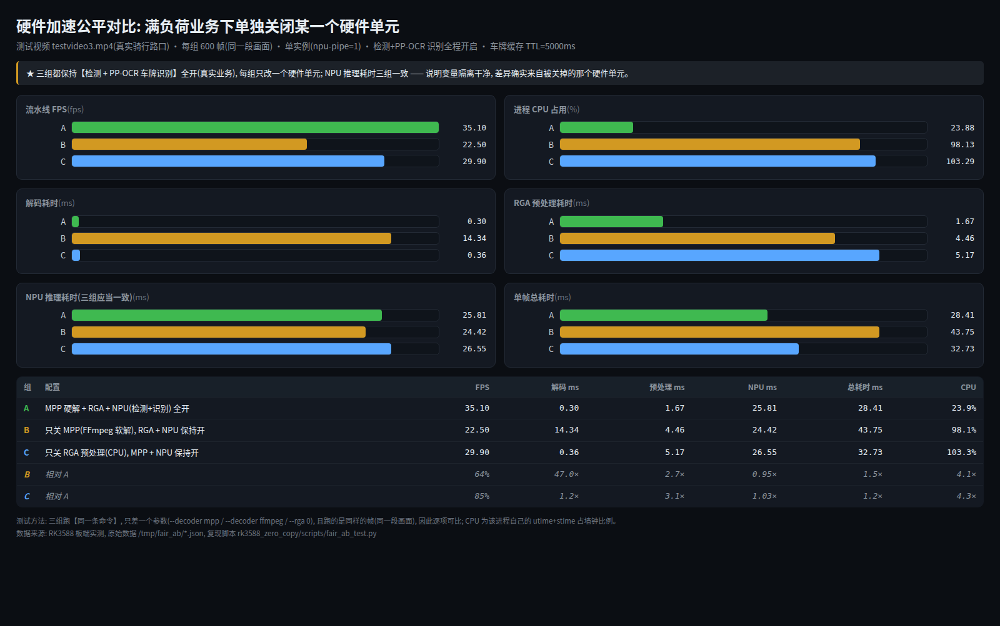
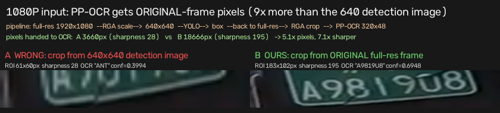

<div align="center">

[](https://github.com/azuleerin/RK3588-Ebike-Gate-System) [](https://github.com/azuleerin/RK3588-Ebike-Gate-System) [](https://github.com/azuleerin/RK3588-Ebike-Gate-System) [](LICENSE) [](https://github.com/azuleerin/RK3588-Ebike-Gate-System) [](rk3588_zero_copy/CMakeLists.txt) [](https://github.com/azuleerin/RK3588-Ebike-Gate-System/releases)

# RK3588 边缘 AI 大门感知系统

### RK3588 Edge-AI Gate Perception System

**非机动车路口智能感知终端 · 硬件加速零拷贝流水线 · 长跑验证交付**

[📄 交付白皮书 (PDF)](docs/RK3588边缘AI系统交付白皮书.pdf) · [📊 PPT 数据与素材包](docs/PPT_ASSETS.md) · [📁 文档索引](docs/README.md) · [🚀 Release v2.0-gate-4ch](https://github.com/azuleerin/RK3588-Ebike-Gate-System/releases/tag/v2.0-gate-4ch)

</div>

---

## 项目简介 · Overview

本项目是基于 Rockchip **RK3588** 的边缘 AI **电动车检测、测速与车牌识别**系统，面向小区/路口非机动车道闸场景。
整条链路走 **MPP 硬解 → RGA 零拷贝预处理 → NPU 推理 → CPU 后处理 → MQTT 上报**，全链一帧图像只存在**一份物理内存，零 CPU 拷贝**。
系统已在**单块板子上跑通 4 路并发**，并通过 **9.44 小时 / 827,280 帧**无人值守长跑验证 —— **零崩溃、内存零增长**。

> **交付状态**：整条链路在 RK3588 上跑满 **25 FPS**（相机源上限），9.44 小时长跑零崩溃、内存零增长、热量余量 44 °C，
> 并提供一条可重复执行的 `./run_acceptance_demo.sh` 一键验收命令（连续 3 次 9/9 全部通过）。

## 核心亮点 · Key Features

| | 能力 | 实证 |
|---|---|---|
| ⚡ | **MPP 硬解 + RGA 零拷贝**<br>全链 **0 次** CPU memcpy | 解码比 FFmpeg 软解快 **37.6×**，RGA 预处理比 OpenCV 快 **4.9~7.6×**；关掉硬解 CPU 立刻从 **23.9% → 98.1%** |
| 🧠 | **NPU 三核全局调度**<br>检测双实例 + 识别独立绑核 | 4 路并发下三个 NPU 核分别跑到 **85% / 89% / 65%**，最忙核留 35% 余量 |
| 🔤 | **PP-OCRv4 车牌识别**<br>6625 字符集，**含省份汉字** | 整牌准确率 **86.64%**、单字符 **97.06%**（217 张实拍车牌，FP16） |
| 🎯 | **像素保真 ROI**<br>车牌从 **1080P 原帧**裁，不是 640 检测图 | 送进 OCR 的有效像素 **5.1×**、清晰度 **7.1×** —— 这是识别能不能用的分水岭 |
| 📈 | **内存绝对平线**<br>48,000 帧活堆净增 **+31 KB** | 泄漏斜率从 **+0.612 KB/帧** 降到 **+0.0006 KB/帧**，**降了 1000 倍** |
| 🖥️ | **Web 控制台 3.0**<br>开关真联动板端，不是前端假开关 | MPP 开关点下去，板端解码后端**真的**从 MPP 切到 FFMPEG；断线自动重连 |

## 性能指标 · Performance

> 全部为 **RK3588 板端实测**，无估算。原始数据与复现脚本见 [`docs/PPT_ASSETS.md`](docs/PPT_ASSETS.md)。

| 场景 | 指标 | 实测值 |
|---|---|---|
| **单路生产链路**<br>1920×1080 @25fps | 流水线 FPS | **25.0**（相机源上限，跑满不丢帧） |
| | 整帧耗时 | **39.89 ms** ｜ 解码 0.62 ｜ 预处理 2.35 ｜ NPU 27.87 ｜ 后处理 0.47 |
| **单路离线压测**<br>600 帧 · 检测+识别全开 | FPS | **35.10** |
| | CPU 占用 | **23.9%** |
| **4 路并发**<br>同板 · 10 分钟 | NPU 三核占用 | **85% / 89% / 65%**（峰值 95%） |
| | CPU 总占用 | **34.5%**（峰值 59.0%） |
| | 4 路 RSS 合计 | **392 MB**（峰值 401 MB）· **10 分钟零增长** |
| | 各路交付 FPS | 14.3 / 18.6 / 17.8 / 19.9（近景带识别 ×2 + 高位测速 ×2） |
| **长跑稳定性** | 连续运行 | **9.44 h** ｜ **827,280 帧** ｜ **0 次崩溃** ｜ 满帧率 25.00 fps |
| | 内存平线 | 48,000 帧：活堆 **+31 KB**、RSS **+96 KB** |
| | 温度 | 峰值 **40.7 °C**，距 85 °C 降频线**余量 44 °C** |

### 硬件加速：公平 A/B/C 对比

三组跑**同一条命令、同样 600 帧画面**，都保持【检测 + PP-OCR 识别】全开（真实业务负载），每组**只关一个硬件单元**。

| 组 | 配置 | FPS | 解码 ms | 预处理 ms | NPU ms | 单帧总耗时 | **CPU** |
|---|---|---|---|---|---|---|---|
| **A** | MPP 硬解 + RGA + NPU **全开** | **35.10** | 0.30 | 1.67 | 25.81 | 28.41 ms | **23.9%** |
| **B** | **只关 MPP**（FFmpeg 软解） | 22.50 *(−36%)* | **14.34 (47×)** | 4.46 | 24.42 | 43.75 ms | **98.1% (4.1×)** |
| **C** | **只关 RGA**（CPU 预处理） | 29.90 *(−15%)* | 0.36 | **5.17 (3.1×)** | 26.55 | 32.73 ms | **103.3% (4.3×)** |

> **结论**：关掉硬解，每路多烧 **0.75 个核**；**12 路就多烧 9 个核，而一块板只有 8 个。**



### 单板 4 路大门：单进程 + NPU 全局调度（v2.0）

4 路大门原来是**4 个独立进程**（每路一个 `rk_zero_copy`）。进程之间共享不了 RKNN 上下文，
于是：识别任务（PP-OCR，一次 ~24 ms）和检测任务（YOLO，一次 ~30 ms）在 NPU 队列里**权重一样**，
近景车道的识别会被检测压住；4 份进程各带一份模型 + 一份推理栈，**内存和 CPU 都是 4 倍**。

`rk_gate` 把 4 路收进**一个进程**，共用一条按优先级排的任务队列：

```
   通道线程 ch1..ch4                全局队列                    worker 线程
   解码 → RGA → 提交 DET      →   [OCR(pri=1) 先]     ←     OCR worker @ Core0
   裁 ROI → 提交 OCR              [DET(pri=0) 后]     ←     DET worker @ Core1
   跟踪/测速/上报                                            DET worker @ Core2
```

- **每颗核一个 worker，worker 在自己线程里建 RKNN 上下文**（RKNN 上下文不能跨线程用）
- **每核闸门**：同一颗核上识别永远排在检测前面 → **识别通道不会饿死**
- **每路独立标定/跟踪/缓存**，一路的慢不会拖垮另一路；MQTT 上行**按通道号**分 topic

```bash
./rk3588_zero_copy/scripts/run_4ch_gate_single.sh 600 20   # 单进程 4 路
./rk3588_zero_copy/scripts/run_4ch_gate_ab.sh    600 20   # 两种拓扑的公平 A/B(同源同参)
```

| | 4 个独立进程 | **1 个进程（rk_gate）** | 变化 |
|---|---|---|---|
| **NPU 三核占用合计** | 173.2% | 173.6% | **持平**（同样的算力） |
| 各核占用 | 70.1 / 78.1 / **25.0**% | **19.1** / 77.2 / 77.3% | 从"一核空转"变成"按需分配" |
| **4 路交付 FPS 合计** | 58.87 | **73.24** | **+24%** |
| 各路交付 FPS | 11.11 / 17.62 / 17.06 / 13.08 | **15.35 / 19.71 / 18.62 / 19.56** | **+38% / +12% / +9% / +49%** |
| CPU 总占用 | 67.5% | 65.7% | −3% |
| 4 路 RSS 合计 | 253 MB | **194 MB** | **−23%** |
| RGA / VPU | 53.0% / 6.5% | 53.2% / 16.1% | 持平 / 解码器不再空转 |

> **同样的 NPU 算力，单进程多换出 24% 的吞吐** —— 差别不在算力，在**调度**：
> 4 个进程时同一个核被两个进程抢，谁先谁后由驱动决定；1 个进程时所有路共用一条
> 按优先级排的队列，识别永远排在检测前面，每路还按"谁空谁上"动态分配。

> 两轮用**完全相同的 4 个源、完全相同的参数**跑（`run_4ch_gate_ab.sh` 里同一个采样器、
> 同一块板、先后紧挨着跑），且统计窗口剔除了"板上有别的进程在跑"的时段。
> 原始数据：`logs/gate_4ch_base_ab/`（A）与 `logs/gate_4ch_single_ab/`（B），
> 汇总：`logs/gate_4ch_ab/summary.txt`。

### 像素保真度：车牌从哪裁，决定能不能用

同一块真车牌（苏A / A98190B），两种裁法：

| | A ❌ 从 640 检测图裁 | B ✅ 从 1080P 原帧裁（本工程） |
|---|---|---|
| ROI 像素 | 61×60（3,660 px） | **183×102（18,666 px）** |
| 有效像素比 | 1.0× | **5.1×** |
| 送进 OCR 那行的清晰度 | 27.5 | **195.3（7.1×）** |
| **PP-OCR 读出** | `ANT` (conf 0.3994) | **`A9819U8`** (conf 0.6948) |



### 推理流水线

```
                     ┌──────────────────── RK3588 (8×A55 / NPU×3 / VPU / RGA) ────────────────────┐
                     │                                                                       │
  RTSP / 文件 ──► MPP 硬解 ──► NV12 dma-buf(fd) ──► RGA 缩放+letterbox ──► NPU INT8 推理 ──► CPU 后处理 ──► MQTT QoS1
                     │  VPU 0.62ms    0 次 CPU 拷贝        RGA 2.35ms       27.87ms          DFL+NMS        JSON
                     │                    │                   │                │            跟踪 / IPM 测速
                     │                    │                   │                │                │
                     │                    └───────────────────┴────────────────┤                │
                     │                                         ┌──────────────┴──────────────┐  │
                     │                                         │  NPU 三核全局调度 (npu_pool) │  │
                     │                                         │  Core0 / Core1 = 检测双实例  │  │
                     │                                         │  Core2         = PP-OCR 识别 │  │
                     │                                         └─────────────────────────────┘  │
                     │                                                                       │
                     └───── ROI: 从【原帧】裁车牌 → RGA 缩到 320×48 → PP-OCRv4 rec ──────────┘
```

## 目录结构 · Directory Structure

```
rk_deploy/
├── README.md                    # ★ 本文件 —— 项目主页
├── LICENSE                      # MIT 协议
├── .gitignore
├── run_acceptance_demo.sh       # 一键验收（薄包装，逻辑在 scripts/）
│
├── rk3588_zero_copy/            # ★ 主工程：C++17 零拷贝推理流水线
│   ├── CMakeLists.txt
│   ├── src/
│   │   ├── main.cc              # 单路生产入口
│   │   ├── gate_main.cc         # 4 路大门入口（单进程多路）
│   │   ├── mpp_decoder.cc       # MPP 硬解
│   │   ├── rga_convert.cc       # RGA 零拷贝预处理
│   │   ├── yolo_post.cc         # DFL 解码 + NMS
│   │   ├── license_plate_rec.cc # PP-OCRv4 车牌识别
│   │   ├── speed_track.cc       # IPM 测速
│   │   ├── ipm.cc               # IPM 单应变换
│   │   ├── mqtt_pub.cc          # MQTT QoS1 上报
│   │   ├── rk_base/             # npu_pool 三核调度 / 帧池 / 内存 guard
│   │   └── minimal/             # 最小可运行单元（崩溃二分用）
│   ├── include/rk/              # npu_pool.h / core_mask.h / mem_guard.h / plate_roi.h ...
│   ├── scripts/                 # 压测 · 报告 · 控制台 · 量化对比脚本
│   ├── docs/                    # 工程内技术文档 + 图表（白皮书外的深水区）
│   ├── third_party/             # librknnrt.so / librga.so / 头文件
│   ├── cmake/                   # 交叉编译 toolchain
│   ├── tests/                   # 自检 / RGA / 静态过滤 单元测试
│   ├── udev/                    # 设备规则
│   ├── model/                   # ← models/ 的硬链接镜像（gitignore）
│   └── build/                   # 编译产物（gitignore）
│
├── models/                      # ★ 模型单一真源（.rknn + 标签 + 字典）
├── accuracy/                    # 精度回归：INT8 vs FP16 对比 + 报告
├── docs/                        # ★ 交付文档索引（白皮书 / 压测报告 / PPT 素材）
│   └── assets/                  # PPT 图表与 Web 控制台截图
├── scripts/                     # 板端运维：验收 / 长跑 / 崩溃取证 / systemd 单元
├── tools/                       # 板端诊断探针 + 模型镜像同步
├── _bench/                      # NPU 微基准与模型转换工具链（大部分 gitignore）
└── archive/
    └── rk12ch/                  # ⛔ 已冻结的历史 Python 实验分支（只读设计参考）
```

> **`archive/rk12ch/` 说明**：这是 2026-11 早期的多路 Python 实验工程（ctypes 直连 dmabuf/RGA/RKNN/MPP）。
> 它的 4 层解耦与多核分工思路是对的，但 ctypes 把指针和内存布局全藏起来了，**无法用于硬挂死归因**，
> 且与 C++ 主线并存会让二分定位彻底失效 —— 因此已于 2026-11-12 **整体冻结**（见 `archive/rk12ch/README.QUARANTINE.md`）。
> 现在只作为**最终业务形态的设计参考**保留，**不再开发、不接流水线**。

## 快速启动 · Quick Start

### 0️⃣ 前置：克隆后重建模型镜像

`models/` 是模型的**单一真源**；`rk3588_zero_copy/model/` 只是它的硬链接镜像（git 不保留硬链接，故不入库）。

```bash
git clone https://github.com/azuleerin/RK3588-Ebike-Gate-System.git
cd RK3588-Ebike-Gate-System
tools/sync_model_links.sh          # 重建镜像（跨文件系统自动退化为符号链接）
```

### 1️⃣ 编译（RK3588 板端原生）

```bash
cd rk3588_zero_copy
cmake -B build -DCMAKE_BUILD_TYPE=Release && cmake --build build -j4
```

> 默认打开 `-DUSE_MPP=1 -DUSE_RGA=1 -DUSE_NPU=1`。需要 CPU 对照组时用 `-DUSE_MPP=0 -DUSE_RGA=0 -DUSE_NPU=0`。

### 2️⃣ 跑 4 路并发 Demo

```bash
cd rk3588_zero_copy
./scripts/run_4ch_gate_demo.sh 600 20        # 4 个独立进程（实测口径）
./scripts/run_4ch_gate_single.sh 600 20      # 单进程 4 路（全局 NPU 线程池）
```

> 用法：`run_4ch_gate_demo.sh [时长秒] [最大分析帧率]`。4 条独立流水线跑在同一块板子上：
> Ch1/Ch3 近景（带 PP-OCR 车牌识别），Ch2/Ch4 高位（IPM 测速）。

### 3️⃣ 打开 Web 控制台

```bash
cd rk3588_zero_copy
sudo ./scripts/start_console_stack.sh        # → http://<板子IP>:8080/
```

> 用 `sudo` 跑：NPU / RGA 的负载节点在 root-only 的 `/sys/kernel/debug/` 下。
> 控制台可实时看 FPS / CPU / NPU 三核负载 / 内存曲线，**MPP、RGA 开关是真联动板端的**。

### 🎯 一键验收（给客户演示用）

```bash
./run_acceptance_demo.sh                    # 9/9 项检查，连续 3 次运行全部通过
./run_acceptance_demo.sh --source rtsp     # 换成现场真实相机
```

## 模型清单 · Models

| 文件 | 用途 |
|---|---|
| `ebike_int8_rk2332.rknn` | **生产检测模型** — YOLOv8 双输出形态 C，INT8，640×640，person / ebike |
| `ppocrv4_rec_fp16.rknn` | **交付车牌识别模型** — PP-OCRv4 rec，FP16，320×48，**6625 类含省份汉字** |
| `ppocrv4_rec_int8.rknn` | 车牌识别 INT8 版（算力紧张时用；整牌准确率 80.65%） |
| `ppocr_keys_v1.txt` | PP-OCR 字典（6625 类，运行时必读） |
| `lprnet_finetuned_int8.rknn` | 旧版 LPRNet 车牌模型（34 个 ASCII 字符集，**认不出省份字**，保留对照） |
| `labels_ebike.txt` | 人/车模型标签 |

> ⚠️ `ebike_int8.rknn` 由 toolkit **2.5.0** 编译，板端运行时是 **2.3.2**，加载会失败 —— 生产必须用 `ebike_int8_rk2332.rknn`。

## 交付文档索引 · Documentation

| 文档 | 内容 |
|---|---|
| **[交付白皮书 PDF](docs/RK3588边缘AI系统交付白皮书.pdf)** | **正式交付件**：架构 / 性能实测 / 9.44 小时长跑 / 操作手册 / 排错 / 风险清单 / 交付清单 |
| [白皮书 Markdown 源](docs/RK3588边缘AI系统交付白皮书.md) | 白皮书的可编辑源，改这里再用 `md_to_pdf.sh` 重新出 PDF |
| [PPT 数据与素材包](docs/PPT_ASSETS.md) | 做汇报直接抄：4 路压测结论、硬件加速公平 A/B/C、像素保真度、控制台截图清单 |
| [12 通道评测报告](docs/FINAL_12CH_EVAL.md) | NPU 并发能力定频实测、ROI 分辨率仿真、端到端 MQTT 报文统计 |
| [NPU 定频与并发报告](docs/NPU_FREQ_LOCK_REPORT.md) | 定频前后延迟抖动对比（P99 −7.1%）、4/6 路吞吐实测 |
| [系统能力对照表](rk3588_zero_copy/docs/SYSTEM_CAPABILITY_TABLE.md) | 各硬件加速路径的逐项加速比 |
| [零拷贝链路解析](rk3588_zero_copy/docs/ZERO_COPY_MPP_RGA.md) | dmabuf fd 全链路穿透细节，0 次 CPU memcpy 的证据 |
| [Web 控制台说明](rk3588_zero_copy/docs/WEB_CONSOLE.md) | 控制台 3.0 功能、开关联动语义、压测复现步骤 |
| [风险清单](rk3588_zero_copy/docs/RISK_REGISTER.md) | 已知风险与未闭环项（**汇报前请先读这份**） |
| [现场环境适配指南](rk3588_zero_copy/docs/现场环境适配指南.md) | 机位 / 光照 / 相机标定的现场落地建议 |
| [崩溃调试规约](docs/AGENT_RULES_FOR_CRASH_DEBUGGING.md) | 本项目所有稳定性决策的依据（可二分、可回滚） |
| [视频专项报告](docs/DEMO_VIDEO_REPORT.md) · [实路视频报告](docs/REAL_ROAD_VIDEO_REPORT.md) | 素材级回归：车牌 ROI 几何、测速精度、已知问题 |
| [精度回归报告](accuracy/ACCURACY_REPORT.md) | INT8 vs FP16 量化损失实测（检测 + 识别） |

## 许可协议 · License

本项目采用 [MIT 协议](LICENSE) 开源。板端依赖的 Rockchip 运行时（`librknnrt.so` / `librga.so`）版权归 Rockchip 所有，
随 `third_party/` 一并提供，仅用于在 RK3588 上运行本项目。

---

<div align="center">
<sub>Made with 🔧 on Rockchip RK3588 · 所有性能数据均为板端实测，可按 <code>docs/</code> 中的脚本复现</sub>
</div>
