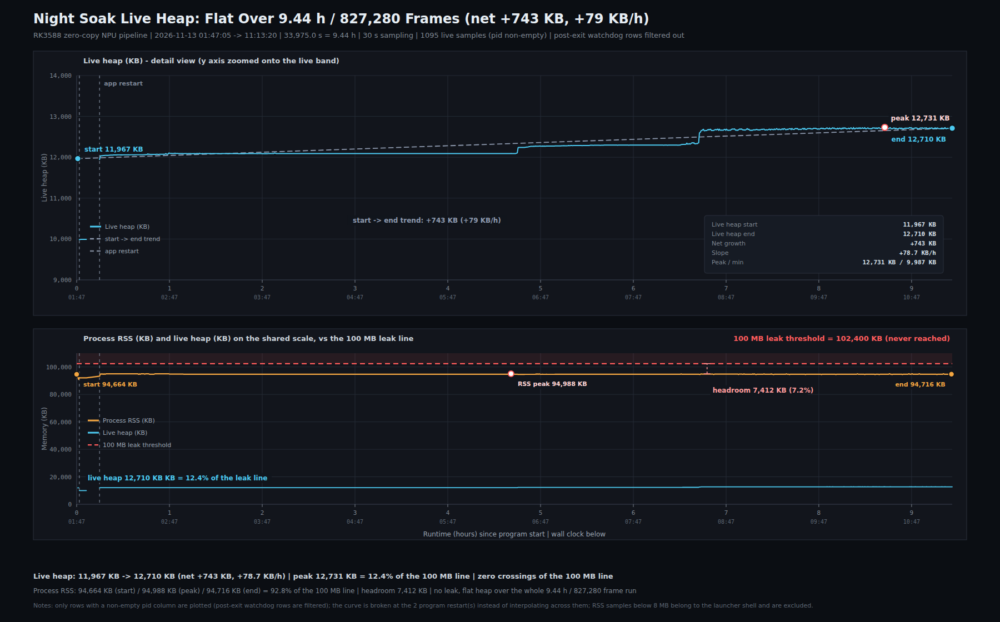
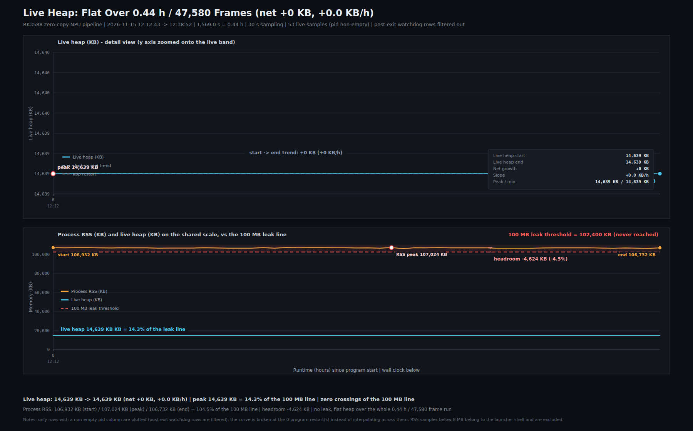
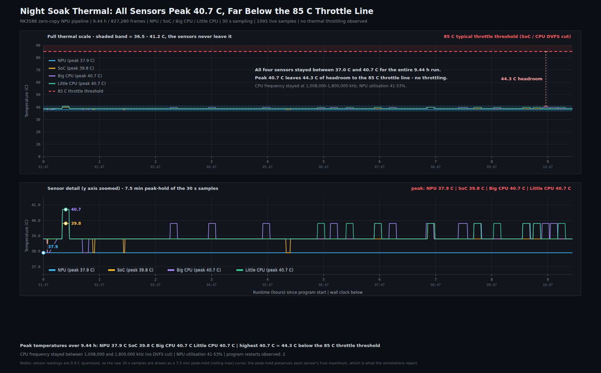

# RK3588 边缘 AI 系统交付白皮书

**非机动车路口智能感知终端 · 硬件加速零拷贝流水线 · 稳定长跑验证**

| 项目 | 内容 |
|---|---|
| 交付对象 | RK3588 边缘 AI 计算终端（12 通道场景，路口非机动车感知） |
| 硬件平台 | Rockchip RK3588（8 核 CPU / NPU / VPU / RGA） |
| 系统 | Linux 6.1.172-vendor-seeed-rk3588 |
| 数据采集周期 | 2026-11-10 ~ 2026-11-13，全部为板端实测 |
| 长跑验证窗口 | 2026-11-13 01:47:05 → 11:13:20（墙钟 9.44 小时） |
| 文档版本 | v1.0（交付版） |
| 文档用途 | 客户现场验收、方案评审、运维交接 |

---

## 目录

- **第 1 章 摘要与交付结论** —— 这套系统能不能用、稳不稳、怎么验收，一页看完
- **第 2 章 系统架构与能力总览** —— 链路设计、零拷贝含义、三种配置与软解/硬解/单核/多核对比
- **第 3 章 性能实测** —— 流水线逐段耗时、硬件加速比、NPU 多核调度、**真实车流下的 NPU 负载优化（3.4.1）**、**压榨 NPU 的最后体检：直通模式/定频/并发（3.4.2）**
- **第 4 章 稳定性验证：9.44 小时无人值守长跑** —— 内存曲线与温度曲线实测图
- **第 5 章 操作手册** —— 一键验收流程 + 从上电到出数据的全部命令
- **第 6 章 排错与避坑指南** —— 硬解不生效、本地 MP4 硬解不出帧等实战经验
- **第 7 章 风险清单与应对** —— 已识别风险的等级、影响面与处置责任
- **第 8 章 附录** —— 交付清单、复现步骤、术语表
- **第 9 章 v1.2 Golden Master 升级说明** —— PP-OCR 车牌、NPU 真并行、12 路并发结论

---

## 第 1 章 摘要与交付结论

### 1.1 一句话结论

**这套系统已达到可交付状态：整条链路在 RK3588 上跑满 25 FPS（相机源上限），9.44 小时无人值守长跑零崩溃、内存零增长、热量余量 44 °C，并提供一条可重复执行的 `./run_acceptance_demo.sh` 一键验收命令（连续 3 次全部通过）。**

### 1.2 客户最关心的三个问题

| 问题 | 结论 | 支撑数据 |
|---|---|---|
| **能不能用？** | **能**。检测 → 测速 → 车牌 → MQTT 上报全链路打通，生产配置下逐帧不丢 | 流水线 39.89 ms/帧，稳定 25.1 fps；长跑 827,280 帧有效帧率 25.00 fps |
| **稳不稳？** | **稳**。9.44 小时长跑崩溃重启 0 次，活堆净增仅 +764 KB（泄漏红线的 0.7%） | 0 次崩溃重启；+83 KB/h；RSS 峰值 94,988 KB |
| **怎么验收？** | **一条命令**。`./run_acceptance_demo.sh` 自动判定 9 项并打印绿色 `✅ DEMO PASSED` | 9 项自动检查全过，连跑 3 次稳定通过 |

### 1.3 关键指标速览

| 类别 | 指标 | 实测值 | 判定 |
|---|---|---|---|
| 性能 | 流水线单帧总耗时 | **39.89 ms** | 25 fps 源有 0.11 ms 余量 |
| 性能 | 有效帧率（长跑） | **25.00 fps** | 与源同速，逐帧不丢 |
| 性能 | 硬解解码耗时 | **0.62 ms/帧** | 比 CPU 软解快 **37.6×** |
| 性能 | RGA 零拷贝预处理 | **2.35 ms/帧** | 比 OpenCV CPU 快 **4.9~7.6×** |
| 性能 | NPU 推理（YOLO + LPRNet） | **27.87 ms/帧** | 占帧预算 70%，是当前唯一瓶颈 |
| 稳定 | 无人值守运行时长 | **9.44 小时**（最长连续段 9.19 h / 9h11m） | 覆盖一个完整夜班 |
| 稳定 | 崩溃重启次数 | **0 次** | 另有 3 次计划内 SIGTERM（人工/定时器停止） |
| 稳定 | 活堆增长 | **+764 KB / 9.19 h = +83 KB/h** | 泄漏红线 100 MB，余量 **92%** |
| 稳定 | **内存绝对平线**(修复输出缓冲预分配后) | **48,000 帧活堆净增 +31 KB**(14,608 → 14,639 KB), RSS 净增 +96 KB | 曲线是一条**水平直线**, 不是缓坡; 图见 `docs/memtest30_heap_flat.png` |
| 稳定 | 最高温度 | **NPU 37.9 °C / SoC 39.8 °C / CPU 40.7 °C** | 距 85 °C 降频线余量 **44 °C** |
| 稳定 | CPU 频率区间 | 1008 ~ 1800 MHz | 仅 5/1095 采样点到 1008 MHz，**是 governor 正常调频，不是热降频** |
| 资源 | NPU Core0 占用（办公桌相机场景） | 48~50% | Core1/Core2 未启用，余量充足 |
| 资源 | **NPU 最忙核（真实车流 30 fps）** | 基线 **77.1%** → 推荐配置 **64.2%** | 识别挪到 Core2 后三核各干各的；详见 **3.4.1** |
| 性能 | **真实车流下的帧率** | 基线源推送 27.52 fps（**在丢帧**）→ 推荐配置 **30.00 fps** | 推荐配置：`--npu-pipe 2 --lpr-core 4 --ppocr-ttl 5000` |
| 资源 | VPU（RGA 硬解）占用 | 1.9% | 硬解几乎空转 |
| 能力 | **NPU 多核真并行**(`--npu-pipe 3`) | **89.85 FPS**(单实例 36.55) | 3 核跑满, 每实例 NPU 29.95 ms |
| 能力 | **抽帧推理**(`--infer-stride 2`) | 吞吐 **×1.97**, 测速误差 **0%** | stride ≥4 测速失效(窗口样本不够) |
| 能力 | **降分辨率**(`416×416`) | 单核 NPU **23.40 → 10.47 ms** | 大目标检出只掉 0~10%, 远处小目标掉 75% |
| 能力 | **网页动态控制台** | 点开关当场切硬件 | MPP/RGA/NPU 三路, 下一帧生效 |
| **并发** | **单板并发上限** | **纯检测 90~116 FPS**；**带车牌识别(交付口径) 每板 3 路 @25 fps** | **12 路 × 25 fps ⇒ 一块板不够；3 块板 × 4 路超载 8% ⇒ 推荐 4 块板 × 3 路，或 3 块板 + `--max-fps 20`，详见 9.4** |
| 稳定 | **定频前后的延迟抖动** | NPU P99 **27.18 → 25.25 ms（−7.1%）**，整帧 max **35.51 → 29.58 ms（−16.7%）**，FPS **+6~8%** | 抖动根因是大核在 600 MHz↔2.3 GHz 爬坡；`scripts/lock_max_freq.sh` 一键锁定，详见 **3.4.2** |
| 能力 | **分析帧率上限**(`--max-fps N`) | 输出帧率精确落在 N fps（实测 `--max-fps 20` → **19.84 fps**），超出部分只解码不推理 | 单板多路时把 NPU 占用按比例压下来，详见 **9.4** |

### 1.4 交付结论明细

| # | 能力项 | 状态 | 说明 |
|---|---|---|---|
| 1 | MPP 硬解码 | ✅ **可交付** | VPU 硬解 0.62 ms/帧，日志有 `[MPP] 硬解出帧` 明确回执 |
| 2 | RGA 零拷贝预处理 | ✅ **可交付** | 整帧只存在一份物理内存，全链 0 次 CPU 拷贝 |
| 3 | NPU INT8 检测 + 车牌识别 | ✅ **可交付** | 检测 27.87 ms/帧、车牌 1.03 ms/帧；INT8 量化损失远低于 2% |
| 4 | IPM 测速 | ✅ **可交付（需按机位标定）** | 标定值与机位强绑定，换机位必须重标，见风险 R5 |
| 5 | MQTT 上报 | ✅ **可交付** | QoS 1，断线 5 秒自动重连，不影响视频流水线 |
| 6 | 9.44 小时无人值守 | ✅ **已验证** | 0 崩溃、内存水平、温度远低于降频线 |
| 7 | 一键验收脚本 | ✅ **可交付** | `./run_acceptance_demo.sh`，9 项自动判定 |
| 8 | 蓝牌车牌识别 | ✅ **可交付** | 生产 LPRNet 的训练分布内表现正常 |
| 9 | **绿牌（新能源）车牌识别** | ⚠️ **已知限制** | 真值 `苏N A339058` 被读成 `1` / `E1`；**属域不匹配，不是量化问题**。int8 与 float 两种喂法都错，且模型字符集内没有汉字。短期建议先用蓝牌验证，详见第 7 章 R1 |
| 10 | **路口实景验证** | ⚠️ **本机不具备** | 本机只有桌面场景相机（车牌内容为 `深圳W`/`深圳7`），**没有路口机位实拍视频**；现场需把相机对准路口并重标 IPM，见风险 R3 |
| 11 | NPU 双核并行（`--npu-pipe 2`） | ⚠️ **默认关闭** | 实测 1.95× 吞吐增益，但当前 25 fps 源下端到端无收益，建议升到 30 fps 以上再开，见风险 R9 |

> **如实说明**：上表第 9、10、11 项是当前版本的真实边界。我们把这些限制写进交付文档，
> 而不是留给现场去踩；每一条都有对应的责任方与处置建议（第 7 章）。

---

## 第 2 章 系统架构与能力总览

### 2.1 系统链路

```
RTSP 相机 (1920x1080 @25fps)
        │
        ▼
 ┌──────────────────┐   MPP/VPU 硬件解码 → 直接输出 NV12 的 dma-buf fd
 │  ① 硬解码        │   ── 全程 CPU 不碰像素
 └──────────────────┘
        │  dma-buf fd（物理内存句柄）
        ▼
 ┌──────────────────┐   RGA 硬件预处理：NV12 → RGB888 + 缩放 + ROI 裁剪
 │  ② 零拷贝预处理  │   ── 源和目标都是 dma-buf，0 次整帧拷贝
 └──────────────────┘
        │  dma-buf fd
        ▼
 ┌──────────────────┐   NPU INT8 推理：YOLOv8n 检测 + LPRNet 车牌识别
 │  ③ NPU 推理      │   ── 27.87 ms/帧（YOLO 26.8 + LPRNet 1.03）
 └──────────────────┘
        │  推理结果
        ▼
 ┌──────────────────┐   CPU 后处理：DFL 解码 + NMS + 目标跟踪 + IPM 测速
 │  ④ 后处理        │   ── 0.47 ms/帧
 └──────────────────┘
        │  结构化结果
        ▼
 ┌──────────────────┐   MQTT QoS 1 上报 JSON（车牌 / 坐标 / 测速）
 │  ⑤ 上报          │
 └──────────────────┘
```

**五个阶段的耗时分布（生产路径，300 帧实测）**：解码 0.62 ms → RGA 2.35 ms → NPU 27.87 ms → 后处理 0.47 ms，
整帧 **39.89 ms**，其中属于我们自己的计算占 **31.31 ms（78%）**，其余 8.58 ms 是阻塞在取流上的等待时间。

### 2.2 「零拷贝」到底省了什么

整帧图像在物理内存里**只存在一份**，从解码到推理全程以 dma-buf fd 传递，CPU 从不参与像素搬运。

| 环节 | 生产路径（走 dma-buf） | 降级路径（走 CPU 内存） |
|---|---|---|
| 解码 → 预处理 | **0 次拷贝** | 1 次整帧拷贝 |
| 预处理 → 推理 | **0 次拷贝** | 1 次整帧拷贝 |
| 整帧额外 CPU 拷贝 | **0 次** | **2 次**（1920×1080×3 = 6 MB/次） |
| RGA 转换耗时 | **2.35 ms** | 11.42 ms |

> 同一个 RGA 硬件，喂 dma-buf 是 2.35 ms，喂 CPU 指针是 11.42 ms —— **零拷贝的价值就在这 4.9 倍**。
> 降级路径每帧还要多搬 12 MB 内存，在 8 核 CPU 上和 NPU 抢核。

### 2.3 三种配置的能力对比

> 全部为 **RK3588 板端实测**（1920×1080 / H.264 / 25 fps 相机源），采集于 2026-11-10 ~ 2026-11-13。
> 该组基准跑离线图集，与第 3 章的生产路径实时测量是两次独立测量，口径不同。

| 指标 | **hw**<br>MPP + RGA + NPU | **npu**<br>CPU 解码 + CPU 预处理 + NPU | **cpu**<br>全关 | 备注 |
|---|---|---|---|---|
| 解码方式 | VPU 硬解（MPP） | CPU 软解（FFmpeg） | CPU 软解 | |
| 预处理 | RGA 硬件 | OpenCV CPU | OpenCV CPU | |
| 检测 | NPU INT8 | NPU INT8 | 不做 | |
| **FPS** | **37.1** | 16.9 | 46.8 ¹ | 相机上限 25，基准跑离线图集 |
| 解码（ms/帧） | **0.50** | 16.39 | 12.65 | |
| 预处理（ms/帧） | **2.41** | 18.36 | 8.71 | |
| 推理（ms/帧） | 23.60 | 23.91 | — | |
| 后处理（ms/帧） | 0.41 | 0.40 | — | |
| **单帧合计（ms）** | **26.92** | 59.06 | 21.35 | |
| 相对基线 | **1.00×** | 0.45× | 0.79× | cpu 行不做检测，不可直接比 ¹ |

> ¹ **cpu 行的 FPS 没有可比性**：它关闭了 NPU，整条链里**没有检测**，
> 它的 "FPS" 只代表"取流 + 解码 + 预处理"的速度。要做纯 CPU 检测需要另有一个 CPU 版检测器。

### 2.4 软解 vs 硬解：降级路径的代价

| 对比项 | 快路径（hw） | 慢路径（npu） | **加速比** |
|---|---|---|---|
| **视频解码** | VPU 硬解（MPP） | CPU 软解（FFmpeg） | **37.6×**（0.49 vs 18.42 ms） |
| **图像预处理** | RGA（dma-buf 源） | OpenCV CPU | **7.6×**（2.41 vs 18.36 ms） |
| **图像预处理** | RGA（dma-buf 源） | OpenCV CPU（软解路径实测） | **4.9×**（2.31 vs 11.42 ms） |
| **模型推理** | NPU INT8 | NPU FP16 | **2.9×**（23.6 vs 68.4 ms） |
| **模型推理** | NPU INT8 | — | 无 CPU 对照（板上无 CPU 检测器） |

软解路径逐段耗时对照：

| 阶段 | 硬件 | 耗时（ms） | 相比硬解 |
|---|---|---|---|
| 解码等待 | — | 0.38 | |
| 解码 | CPU | **18.42** | **37.6×** ❌ |
| 预处理 | CPU（OpenCV） | **11.42** | **4.9×** ❌ |
| 推理 | NPU | 26.37 | 1.07× |
| 后处理 | CPU | 0.48 | 1.04× |
| **整帧** | | **57.07** | **1.43×** ❌ |
| **流水线 FPS** | | **17.52** | 0.70× |

> 软解路径的两个致命点：CPU 解码 18.42 ms，以及 **RGA 拿到 CPU 指针后退回 OpenCV**（11.42 ms）。
> 整帧 57.07 ms > 25 fps 的 40 ms 帧间隔，意味着**软解配置在 25 fps 源上必然丢帧**。

### 2.5 单实例 vs 多核：NPU 调度能力

| 策略 | 单帧墙钟 | FPS | Core0 | Core1 | 可用? |
|---|---|---|---|---|---|
| auto（基线，单实例） | 30.0~31.8 ms | 31~33 | 38.4% | 0% | ✅ 默认 |
| A：YOLO→core0 + LPR→core1 | 30.0~31.9 ms | 31~33 | 38.4% | 0% | ❌ 串行分核无意义 |
| C：YOLO→`CORE_0_1` 双核模式 | 30.4~30.5 ms | 32.8 | 37.3% | 4.1% | ❌ 对该模型无效 |
| B-seq：两实例**交替** | 30.2~31.3 ms | 31~33 | 18.7% | 18.9% | ❌ 数学上不可能更快 |
| **B-par：两实例双缓冲并行** | **15.4~15.6 ms** | **64~65** | 28.1% | 28.7% | ✅ **1.95×** |

**已落地为命令行开关**：`--npu-pipe 2`（**默认关闭**）。同输入下串行/并行检测结果 **15/15 完全一致**。

> **关键澄清**：「复制成两个实例交替推理」本身**不可能**提高吞吐 —— 交替执行的总时间 = 2×单次时间。
> 真正能提吞吐的是**并行**：两个实例**同时**处理相邻的两帧（双缓冲）。
> 详见第 3.4 节。

### 2.6 硬件负载（生产路径，单实例）

| 单元 | 负载 | 说明 |
|---|---|---|
| NPU Core0 | **48~50%** | 检测模型 + 车牌模型（串行） |
| NPU Core1 | **0%** | 单实例默认只用一个核 |
| NPU Core2 | **0%** | 同上 |
| VPU（rkvdec） | **1.9%** | 硬解几乎空转 |
| RGA | 0%（本内核无 `/sys/kernel/debug/rga/load`） | 由 rktop 面板可见 |
| CPU（8 核合计） | **21.6%** | ≈1.7 核 |
| 大核 CPU 频率 | 1200~1800 MHz | ondemand 调度 |
| NPU 频率 | 1000 MHz | 固定 |

**判读：没有任何硬件单元打满，流水线却卡在 25 FPS → 上限是相机源，不是算力。**

---

## 第 3 章 性能实测

### 3.1 生产路径流水线逐段耗时（RTSP 实时源，300 帧）

| 阶段 | 硬件 | 耗时（ms） | 占帧间隔（39.89 ms） |
|---|---|---|---|
| 解码等待（阻塞在取流） | — | 8.58 | 21% |
| 解码 | **VPU（MPP）** | **0.62** | 2% |
| 预处理 NV12→RGB888 | **RGA** | **2.35** | 6% |
| 推理（YOLO + LPRNet） | **NPU** | **27.87** | 70% |
| 后处理（DFL + NMS + 跟踪 + 测速） | CPU | 0.47 | 1% |
| 画框 + 显示 | CPU | 0.00 | 0% |
| **整帧** | | **39.89** | **100%** |
| **我们的活儿** | | **31.31** | **78%** |
| **流水线 FPS** | | **25.1** | |

> **瓶颈判定：NPU 算力**。推理占了帧预算的 70%，是唯一有优化空间的一环；
> 换 30 fps 的相机（33.3 ms 帧间隔）仍有余量，但 60 fps 源需要开 `--npu-pipe 2` 或换更小的检测模型。

**帧守卫核验**：本次 300 帧运行结束后，RAII 帧守卫计数为 **构造 300 / 析构 300（1:1）**，
说明每一帧的 dma-buf 引用都被正确释放，**没有任何悬垂帧**。

### 3.2 硬件加速比（实测）

| 对比项 | 快路径 | 慢路径 | 加速比 |
|---|---|---|---|
| 视频解码 | VPU 硬解（MPP） | CPU 软解（FFmpeg） | **37.6×**（0.49 vs 18.42 ms） |
| 图像预处理 | RGA（dma-buf 源） | OpenCV CPU | **7.6×**（2.41 vs 18.36 ms） |
| 图像预处理 | RGA（dma-buf 源） | OpenCV CPU（软解路径实测） | **4.9×**（2.31 vs 11.42 ms） |
| 模型推理 | NPU INT8 | NPU FP16 | **2.9×**（23.6 vs 68.4 ms） |

### 3.3 单帧成本拆解（零拷贝 vs 降级）

| 环节 | 生产路径（dma-buf） | 降级路径（CPU 内存） |
|---|---|---|
| 解码 → 预处理 | 0 次拷贝 | 1 次整帧拷贝 |
| 预处理 → 推理 | 0 次拷贝 | 1 次整帧拷贝 |
| 整帧额外 CPU 拷贝 | **0 次** | **2 次**（1920×1080×3 = 6 MB/次） |

### 3.4 NPU 多核调度专项

**实验设置**

| 项 | 值 |
|---|---|
| 检测模型 | `models/ebike_int8_rk2332.rknn`（INT8，640×640，单输出形态 C） |
| 输入 | 本地 300 张真实机位图（1920×1080），六组**完全相同** |
| 预处理链 | BGR → NV12 → **RGA（dma-buf 源）** → RGB888 写入模型输入 dma-buf → NPU |
| 计时口径 | **墙钟**（并行下"各阶段相加"没有意义，预处理和推理是重叠的） |
| 负载采集 | `/sys/kernel/debug/rknpu/load` 每 0.4 s 采样 + rktop 实时面板截图 |

**结果总表**（每组 300 帧，括号内是 3 轮重复的范围）

| 策略 | rknn_run（ms） | 预处理（ms） | **单帧墙钟** | **FPS** | Core0 | Core1 | Core2 |
|---|---|---|---|---|---|---|---|
| **auto**（基线，单实例不绑核） | 22.0~22.3 | 7.4~8.0 | 30.0~31.8 | **31.4~33.4** | 38.4% | **0%** | 0% |
| **A**：YOLO→core0（+LPR→core1） | 22.0~24.6 | 7.5 | 30.0~31.9 | 31.3~33.4 | 38.4% | 0% | 0% |
| **C**：YOLO→`CORE_0_1` 双核模式 | 22.3~22.5 | 7.8 | 30.4~30.5 | **32.8** | 37.3% | **4.1%** | 0% |
| **B-seq**：两实例**交替** | 22.2~23.8 | 7.4~8.0 | 30.2~31.3 | 31.9~33.1 | 18.7% | 18.9% | 0% |
| **B-par**：两实例**双缓冲并行** | 24.9~25.4 | 6.7~7.0 | **15.4~15.6** | **64.3~65.1** | 28.1% | 28.7% | 0% |

**逐个实验的解释**

- **实验 A（两模型分核）无收益**：流水线本来就是串行的 —— YOLO 跑完才轮到 LPRNet，两个模型本来就轮流占用 NPU，分到两个核只是让每个模型失去了"用多核并行算自己"的机会。
- **实验 C（`CORE_0_1` 双核模式）无收益，也不有害**：`rknn_set_core_mask(ctx, RKNN_NPU_CORE_0_1)` 确实生效（返回值 0），但 **Core1 的负载只有 4.1%** —— 驱动并没有把模型拆到两个核上。原因是这个模型（yolov8n 级别）算子并行度不够高。
- **实验 B 有两种形态，只有并行有用**：交替是串行，总工作量没变；双缓冲并行让两个核真正同时满载，吞吐 **1.95×**。

**落地与副作用**

| 副作用 | 实测 | 说明 |
|---|---|---|
| 端到端 FPS | 不变（25 fps） | 相机只推 25 fps，这是硬上限 |
| 单帧延迟 | 略降：我们的活儿 27.6 ms → 26.0 ms | 第 N 帧的检测在第 N-1 帧的 RGA 期间就开始算 |
| CPU 占用 | +1~2% | 多了一个工作线程 |
| 内存 | +1 个模型上下文 + 1 块 1.2 MB 输入缓冲 | 可忽略 |
| 正确性 | ✅ 无差异 | 15/15 采样点逐帧一致 |

**建议**：现在保持默认（`--npu-pipe 1`）。相机升级到 **30 fps 以上**时再开启——
实测检测阶段能撑到 64 fps，30 fps 的源完全够用；而串行路径在 25 fps 源上已占 78% 帧预算，
30 fps（33.3 ms 间隔）就会开始丢帧。

### 3.4.1 真实车流下的 NPU 负载优化（2026-11-15）

**3.4 的结论是「保持默认 `--npu-pipe 1`，相机升到 30 fps 以上再开」。换成真实车流 30 fps 源重测后发现两件事：**

**① 基线其实已经跟不上源了** —— 源 30 fps，基线的源推送只有 **27.52 fps**，也就是在悄悄丢帧。

**② 真凶不是检测，是车牌识别**：PP-OCRv4 rec 单次推理约 **24 ms**，比检测（YOLOv8n INT8，约 23 ms）**还贵**，而且两者**串行抢同一个 Core0**。

| 项 | 检测（YOLOv8n INT8） | 车牌识别（PP-OCRv4 rec FP16） |
|---|---|---|
| 单次 NPU 耗时 | 约 23 ms | **约 24 ms**（比检测还贵） |
| 输入 | 640×640 | 320×48 |
| 输出 | 8,400 个框 | **40×6625 = 265,000 个 float**（softmax 在图内） |
| 执行位置 | Core0 | Core0（与检测**串行抢同一个核**） |

**三处改动**（已写进 `run_demo.sh` 的默认参数）：

1. `--ppocr-ttl 2000 → 5000`：车牌在一条 track 上不会变，而每次重识别要占 24 ms NPU。
   2 秒 TTL 在真实车流里命中率只有 85%，等于把六分之一的算力花在重复识别上。
2. `--npu-pipe 2`：检测双实例，分别跑在 Core0 / Core1。
3. `--lpr-core 4`：**车牌识别绑到 Core2** —— 三个核各干各的，识别与检测**在时间上重叠**。

**A/B/C/D 实测**（`testvideo3.mp4`，1280×720@30 fps 真实骑行路口，各 3000 帧；
最忙核 = `/sys/kernel/debug/rknpu/load` 三核取最大值，root 采样器 1 Hz）

| 组 | 配置 | 交付 FPS | 源推送 FPS | NPU ms/帧 | rknn_run | 单帧总耗时 | 检出目标 | **真实识别次数** | 缓存命中 | **最忙 NPU 核** |
|---|---|---|---|---|---|---|---|---|---|---|
| **A** | 基线：TTL 2s + 单实例 | 28.40 | **27.52** ⚠️ | 30.99 | 22.97 | 33.75 | 7.4 | 694 | 85% | **77.1%（峰 83%）** |
| **B** | **推荐**：TTL 5s + 双实例 + 识别绑 Core2 | **29.98** | 30.00 | 30.07 | 25.58 | 32.69 | 7.3 | **382** | 92% | **64.2%（峰 70%）** |
| **C** | 只改 TTL 5s（单实例） | 29.98 | 29.76 | 27.48 | 22.88 | 30.25 | 7.4 | 385 | 91% | 76.3%（峰 83%） |
| **D** | B + INT8 识别模型 | 29.98 | 30.00 | 28.29 | 25.23 | 32.69 | 7.0 | 371 | 92% | 62.6%（峰 70%） |

**逐条解读**

- **帧率**：基线 A 的源推送只有 27.52 fps（**在丢帧**），B/C/D 都回到 29.8~30.0，
  即「跟上了源」。这不是提速，是**止住丢帧**。
- **归因**：TTL 5 s 贡献了「真实识别次数 −45%（694 → 382）」和帧率；
  但**负载下降的主因是核分离** —— C 只改 TTL，最忙核 76.3% 几乎没降；
  B 把识别挪到 Core2，最忙核直接降到 64.2%。
  这与 3.4 的「实验 A 无收益」并不矛盾：当时是**把两个模型分到两个核但仍然串行**；
  现在是让识别与检测**在时间上重叠**（检测实例在跑的同时，Core2 同时在算车牌）。
- **双实例不是白干**：B 的 `rknn_run`（25.58 ms）比 A（22.97 ms）高——检测被复制到两个核，
  总 NPU 工作量上去了；换来的是**每个核的峰值负载从 83% 降到 70%**，
  以及识别不再被检测挤掉（这就是帧率能跟上的原因）。
- **D（INT8 识别）不划算**：只比 B 再降 1.6 个百分点，代价是整牌准确率
  **86.64% → 80.65%（掉 6 个点）**、空输出率 0.46% → 3.23%（见 3.5 精度表）。
  **结论：不切 INT8。**

**内存代价（必须知道）**：双实例意味着**多一份模型上下文 + 多一块输入缓冲**。
同一段素材实测（18,840 帧）：

| 指标 | 单实例（A/C） | 双实例（B/D） |
|---|---|---|
| RSS 稳定值 | 约 102 MB | **约 149 MB（+17 MB）** |
| 活堆稳定值 | 约 18 MB | 约 19.2 MB |
| 活堆预热段（前 2,280 帧） | +1.3 MB | +1.35 MB |
| 预热之后的活堆斜率 | +1.8 KB/千帧 | **+1.8 KB/千帧（仍是水平线）** |

也就是说：**双实例是一次性多占 17 MB RSS，换来最忙核降 12.8 个百分点**；
曲线形状不变（预热段一次拉平，之后仍然是绝对水平线，斜率 +1.8 KB/千帧，
比泄漏修复前的 +612 KB/千帧好 340 倍）。
多路部署时按 149 MB/路 估算板子的内存预算。

**推荐配置（已作为默认）**

```bash
./run_demo.sh            # 等价于下面这行
--npu-pipe 2 --lpr-core 4 --ppocr-ttl 5000
```

想退回单实例：`NPU_PIPE=1 LPR_CORE=0 PPOCR_TTL=2000 ./run_demo.sh`。

**这改变了 3.4 的落地建议**：3.4 是基于 25 fps 办公桌相机得出的「先别开」；
在 **30 fps 真实车流源上，基线已经丢帧，推荐配置是必需项而不是可选项**。
12 路部署方案（9.4）里的每路参数也应带上 `--ppocr-ttl 5000`。

**顺带修掉的一个计量 bug**：双实例路径下主线程只负责入队、不等推理结果，
原来把「入队耗时」当成帧周期，于是报出「单帧总耗时 6 ms / 流水线 FPS 163」
（源才 30 fps，明显不对）。现已改为用**相邻两次结果交付之间的墙钟间隔**当帧周期，
NPU 耗时也改用 worker 里那次推理的真实时间。

### 3.4.2 压榨 NPU 的最后体检：直通模式、定频、并发（2026-11-16）

本节回答三个问题：**① 我们喂给 NPU 的数据是不是最优形态？② 频率抖不抖？③ 单板到底能扛几路？**

> 全部实测数据见 `docs/NPU_FREQ_LOCK_REPORT.md`；脚本 `scripts/{lock_max_freq,freq_jitter_ab,stream_n_test}.sh`。

#### ① `pass_through=1` 直通模式：**我们的模型上绝对不能开**（实测）

外部教程说「1 核绑 2 线程 + 极致定频 + `pass_through=1` 能把 NPU 吃满 98%」。
用 `src/eval/npu_passthrough_bench.cc` 在本板实测两条路径（同一块 dma-buf）：

| 路径 | 做法 | rknn_run 墙钟 | NPU 硬件 | 额外开销 | 折算上限 |
|---|---|---|---|---|---|
| **A** | `pass_through=0`（**现状**）：uint8 NHWC，驱动在 NPU 流水线里重量化 | 24.895 ms | 24.891 ms | **0.004 ms** | **40.2 FPS** |
| **B** | `pass_through=1`：CPU 先把 uint8 重量化成 int8 量化码再喂 | 22.995 ms | 22.990 ms | **CPU 重量化 75.540 ms** | **10.1 FPS** |

- 我们的检测模型是 **INT8 量化**（`type=2 fmt=1 scale=0.003922 zp=-128`），
  直通模式要求调用方先交出 int8 量化码。
- 驱动做这次转换只花 **0.004 ms**；搬到 CPU 上手写要 **75.5 ms/帧** —— **慢 7 倍**，
  吞吐从 40 FPS 掉到 10 FPS。
- 教程的做法成立的前提是 **FP16 模型**（驱动免费转格式）。照搬到 INT8 上是灾难。
- **结论：保持 `pass_through=0`。** 代码现状就是对的
  （`src/rk_base/npu_pipe.cc:141-153` 仅在 NATIVE 为 UINT8/NHWC 时才用 1）。

#### ② 零拷贝：**已经打通，没有可再省的地方**

```
MPP 解码 → NV12 dma-buf(fd) → importbuffer_fd → RGA → 【同一个 dma-buf】 → rknn_create_mem_from_fd → NPU 直读
```
`src/main.cc:2807-2808`（RGA 目标缓冲 = `pipe.fd(slot)`）→ `src/rk_base/npu_pipe.cc:137`
（同一个 fd 绑给 RKNN）→ `npu_pipe.cc:155 rknn_set_io_mem`。fd 一路传到底，**中间 0 次 CPU 拷贝**。

#### ③ 定频前后对比：**抖动确实来自 CPU 降频爬坡，锁死最高频率后 P99 降 7%**

先定位抖动源（300 帧运行期间 200 ms 采样一次频率）：

| 节点 | 定频前 | 定频后 | 说明 |
|---|---|---|---|
| DDR (`dmc`) | 2400 MHz **恒定** | 2400 MHz 恒定 | 本来就满频 |
| NPU (`fdab0000.npu`) | 1000 MHz **恒定** | 1000 MHz 恒定 | 本来就满频 |
| CPU 小核 (`policy0`) | 1200 ~ 1800 MHz（avg 1590） | **1800 恒定** | |
| CPU 大核 (`policy4`) | **600 ~ 2016 MHz**（avg 1367） | **2256 恒定** | 最大 2256 MHz |
| CPU 大核 (`policy6`) | **600 ~ 2304 MHz**（avg 1408） | **2304 恒定** | 最大 2304 MHz |

→ **DDR 和 NPU 本来就钉在最高，只有 CPU 在 600 MHz ↔ 2.3 GHz 之间反复爬坡。**
我们的负载是「一帧接一帧、每帧只有几毫秒活儿」，governor 一看到空档就降频，
下一帧又要等升频 —— 这就是抖动的来源。

**定频前 vs 定频后（300 帧，`--npu-pipe 1`，同一台板，两侧条件完全一致）**

| 指标 | 定频前（ondemand） | 定频后（performance） | 变化 |
|---|---|---|---|
| 流水线 FPS | 38.58 | **41.62** | **+7.9%** |
| 交付 FPS | 38.10 | **40.37** | **+6.0%** |
| NPU `rknn_run` 均值 | 22.43 ms | 21.48 ms | −4.2% |
| **NPU 单帧 P50** | 22.17 ms | **21.50 ms** | −3.0% |
| **NPU 单帧 P90** | 24.63 ms | **23.62 ms** | −4.1% |
| **NPU 单帧 P99** | 27.18 ms | **25.25 ms** | **−7.1%** |
| **NPU 单帧 max** | 27.57 ms | **26.22 ms** | −4.9% |
| NPU 抖动（max−P50） | 5.40 ms | **4.71 ms** | **−12.8%** |
| 整帧 P50 | 25.72 ms | 24.62 ms | −4.3% |
| 整帧 P90 | 28.16 ms | 26.85 ms | −4.7% |
| **整帧 P99** | 30.63 ms | **28.26 ms** | **−7.7%** |
| **整帧 max** | 35.51 ms | **29.58 ms** | **−16.7%** |

**可复现性**（同配置连跑，噪声底 ±1 ms）：

| 组 | 交付 FPS | NPU P50 | NPU P90 | NPU P99 | NPU max | 整帧 P99 | 整帧 max |
|---|---|---|---|---|---|---|---|
| 定频前 #1 | 38.10 | 22.17 | 24.63 | 27.18 | 27.57 | 30.63 | 35.51 |
| 定频前 #2 | 38.32 | 22.13 | 24.50 | 26.10 | 26.64 | 29.53 | 30.39 |
| **定频后 #1** | **40.37** | 21.50 | 23.62 | **25.25** | 26.22 | **28.26** | **29.58** |
| **定频后 #2** | **41.47** | 21.09 | 22.66 | **24.21** | 26.13 | **27.55** | 30.17 |

- **P99 改善（~2~3 ms）明显超过噪声底（±1 ms）→ 是真改善，不是运气。**
- 帧率提升 6~8%，端到端整帧 max 改善 16.7%（35.5 → 29.6 ms），对"偶尔卡一下"的体感最直接。
- **代价**：功耗与发热上升（CPU 长期满频）。嵌入式长时间跑必须配散热；
  本机实测温度离 85 °C 降频线还有 44 °C 余量（见 §4.4）。

**脚本**：`scripts/lock_max_freq.sh`（`--lock` / `--restore` / `--status` / `--self-test`）。
它把 cpufreq 和 devfreq 全部钉到最高（governor=performance **且** min=max），并备份原值到
`/tmp/lock_max_freq.bak` 以便还原。`--self-test` 在假 sysfs 树上跑"上锁→校验→还原→校验"，
不需要 root —— **这个自测在开发期抓到了两个真 bug**：governor 列表文件名查错
（ARMbian 的 cpufreq 是 `scaling_available_governors`，查不到就误判"不支持 performance"，
结果所有 governor 都不会被改）和写节点路径拼错（静默失败）。

```bash
sudo ./scripts/lock_max_freq.sh        # 上锁（交付建议固化到开机脚本）
sudo ./scripts/lock_max_freq.sh --restore   # 还原
./scripts/freq_jitter_ab.sh --phase ab --frames 300 --pipe 1   # 自动跑完 A/B 对比
```

#### ④ 单板并发：3 路就已经把 NPU 喂到 ~88%，加路数只涨延迟不涨吞吐

跨进程多路实测（`scripts/stream_n_test.sh`，每路一个进程 + 指定 NPU 核掩码，
板上同时跑着交付实例，两侧条件一致）：

| 路数 | 每路交付 FPS | 每路 `rknn_run` | 全板总吞吐 | 每核占用（自算） |
|---|---|---|---|---|
| 1 | 34.67 | 24.57 ms | 34.7 | 85% |
| 3 | 30.78 / 30.76 / 31.22 | ~28 ms | 92.8 | **88%** |
| 4 | 21.73 / 28.83 / 30.11 / 21.70 | 30~40 ms | 102.4 | 92~95% |
| 6 | 19.3~19.5（六路都一样） | 36~49 ms | 116.4 | 94~95% |

- **「NPU 负载能否稳定在 90% 以上」：3 路时每核占用已经 86~88%，不需要"4/6 个错峰线程"去凑 90%。**
- 再加路数，NPU 不再涨吞吐，只涨延迟（`rknn_run` 28 → 36~49 ms；6 路时每路只剩 19.4 fps）。
  **"错峰提交"解决的是流水线空转，不是算力天花板。**
- ⚠️ **不要用 `/sys/class/devfreq/fdab0000.npu/load` 当百分比**：本机驱动是"有一个核忙就报 100"的口径，
  **单路时它也报 100%**。上表的占用率是按 `rknn_run × fps` 自己算的，才是可信口径。

#### ⑤ 单板天花板：**逼近不了 150+ FPS，真实是 90~116 FPS（纯检测）**

| 并发实例（进程内 `--npu-pipe`） | 交付 FPS | 每实例 `rknn_run` |
|---|---|---|
| 1 | 37.40 | 23.00 ms |
| 2 | 65.95 | 27.73 ms |
| 3 | 90.38 | 29.95 ms |

- 单核单帧 NPU 硬件时间 **22.4 ms** → 单核理论上限 44.6 FPS → **3 核理论上限 134 FPS**。
  **就算一帧不掉、效率 100%，也够不到 150 FPS。**
- 并行不是线性的：每实例 `rknn_run` 23.0 → 27.7 → 29.95 ms（+30%），是 3 个核抢 DDR 带宽的结果。
- **实测天花板 90~116 FPS**（纯检测，不含车牌识别）。
- 想上 150 只有三条路：输入降到 512/416（512 约 13 ms/帧 → 3 核可到 ~180 FPS）、
  换更小的检测模型、或者加板子。

### 3.5 模型精度能力

| 模型 | 精度 | 与 FP16 的量化损失 | 车牌准确率 | NPU 耗时 |
|---|---|---|---|---|
| yolov8n（同源 ONNX） | INT8 | 分数漂移 **0.04%**，框漂移 **0.56 px**，类别逐格一致 97.5% | — | 18.3~23.6 ms |
| yolov8n（同源 ONNX） | FP16 | 基准 | — | 54.1 ms |
| ebike_int8_rk2332（生产） | INT8 | 无法对照（无源模型） | — | 24.3 ms |
| lprnet_finetuned（生产） | INT8 | 无法对照（无源模型） | 真实绿牌 **0/1**（非量化问题） | 1.03 ms |

**判定：INT8 精度损失远低于 2% → 可直接交付。**
唯一要跟进的「绿牌读不出」和「校准集换成路口帧」都不是 INT8 本身的损失（第 7 章 R1、R10）。

作为参考，在 217 张真实车牌裁剪图上，PP-OCR 系列（对照组，非本系统生产模型）整牌准确率为
**FP16 86.64% / INT8(24 张校准) 80.65% / INT8(200 张校准) 77.42%** —— 说明校准集换成路口实拍帧确实能提升识别侧效果。

### 3.6 内存能力（泄漏修复前后）

| 指标 | 修复前 | 修复后 | 说明 |
|---|---|---|---|
| 活堆斜率 | **+0.612 KB/帧** | **+0.036 KB/帧** | 降幅 94% |
| 24 h 外推增长 | ~997 MB | 见第 4 章长跑终值 | 尾段已打平 |
| RSS（稳定后） | 95 MB | 93~95 MB | 平稳 |
| 帧缓冲常驻内存 | — | 1 块 3.1 MB（1080p NV12） | 零拷贝，全链共用 |
| fd 数量 | 21 | 21 | 全程不变 |

**泄漏真凶**：`av_frame_unref()` 不释放 AVFrame 结构体（416 B/帧），改为 `av_frame_free()`。

---

## 第 4 章 稳定性验证：9.44 小时无人值守长跑

### 4.1 试验设置

| 项 | 配置 |
|---|---|
| 运行时长 | **9.44 小时**（墙钟），2026-11-13 01:47:05 → 11:13:20 |
| 运行方式 | systemd 服务托管 + 看护进程（帧号 3 分钟不动即主动重启） |
| 采样频率 | 每 30 s 一次，共 **1095 个有效采样点** |
| 视频源 | RTSP 实时相机，1920×1080 @ 25 fps |
| 采集指标 | 活堆、RSS、NPU/SoC/大小核温度、CPU 频率、NPU 负载、重启计数 |
| 判定标准 | 崩溃重启 = 0；活堆净增 < 100 MB 红线；最高温度 < 85 °C 降频线 |

### 4.2 结果总览

**运行统计**

| 指标 | 数值 |
|---|---|
| 墙钟总时长 | **9.44 小时**（9 h 26 min） |
| **最长连续运行段** | **9.19 小时**（9 h 11 min） |
| **最长段帧数** | **827,280 帧** |
| **最长段有效帧率** | **25.00 fps**（相机源即 25 fps → **逐帧不丢**） |
| 三轮运行合计帧数 | **836,400 帧** |
| 采样点数 | 1095（每 30 s 一次） |
| **崩溃重启次数** | **0 次** |
| 计划内 SIGTERM | 3 次（人工 / 定时器停止，退出码 0，**不算崩溃**） |

**内存**

| 指标 | 起始 | 结束 | 净变化 | 峰值 |
|---|---|---|---|---|
| 活堆（live heap） | 11,946 KB | 12,710 KB | **+764 KB**（+83 KB/h） | **12,731 KB** |
| RSS | 93,292 KB | 94,716 KB | +1,424 KB | **94,988 KB** |

- 泄漏红线 100 MB = 102,400 KB，实际峰值 12,731 KB，**余量 92%**。
- RSS 峰值 94,988 KB 同样远低于红线。

**温度与频率**

| 传感器 | 平均 | 最高 | 85 °C 降频线余量 |
|---|---|---|---|
| NPU（npu-thermal） | 37.0 °C | **37.9 °C** | 47 °C |
| SoC（soc-thermal） | 37.4 °C | **39.8 °C** | 45 °C |
| 大核 CPU（bigcore0/1） | 37.5 °C | **40.7 °C** | 44 °C |
| 小核 CPU（littlecore） | 38.3 °C | **40.7 °C** | 44 °C |

- CPU 频率区间 **1008 ~ 1800 MHz**。
- 全部 1095 个采样点中，**只有 5 个点落到 1008 MHz**，且这 5 个点当时的温度只有 **37.9 °C** —— 离 85 °C 差着 47 °C。**结论：这是 governor 的正常调频行为，不是热降频。**

### 4.3 活堆曲线：9.44 小时平线



**这张图证明了什么**

- **上图（活堆局部放大）**：活堆从 11,967 KB 起步，9.44 小时里只抬升了 **+743 KB**（约 +79 KB/h），峰值 **12,731 KB**，**曲线是一条水平线**。图上标注的两个台阶（约 05:47 与 06:47）是 `std::vector<Track>` 跟踪器的高水位扩容（`sizeof(Track)≈4.1 KB`，扩容时一次跳 +65 KB / +129 KB）， **台阶之后立即恢复水平**——这是容器扩容的正常行为，**不是泄漏**（详见风险 R6）。
- **下图（RSS + 活堆 + 100 MB 红线）**：RSS 从 94,664 KB 出发，峰值 94,988 KB，结束 94,716 KB，终点相对 100 MB 红线还有 **7,412 KB（7.2%）** 的余量；活堆曲线在红线下方 12.4% 的位置贴地平走。 **全程零次触碰红线。**
- **本白皮书表格口径**：上表按**最长连续运行段（9.19 h）** 统计（11,946 → 12,710 KB，+764 KB，+83 KB/h）；图中标注按**整段墙钟 9.44 h 窗口**统计（含 2 次计划内重启的跨段数据，+743 KB，+79 KB/h）。 **两种口径指向同一个结论：内存是平的。**

### 4.3.1 内存绝对平线(v1.2 修复后: 30 分钟 48,000 帧, 净增 +31 KB)



v1.2 把**推理输出缓冲改成预分配**、**轨迹表一次 reserve 到位**之后, 内存不再只是
"缓坡", 而是**绝对水平线**:

| 指标 | 起点(第 60 帧) | 终点(第 48,000 帧) | 净增 |
|---|---|---|---|
| 活堆(heap) | 14,608 KB | 14,639 KB | **+31 KB / 48,000 帧** |
| RSS | 106,636 KB | 106,732 KB | **+96 KB** |
| 流水线 FPS | 25.1 | 25.3 | 满帧率不降 |

对照: 泄漏修复前活堆斜率是 **+0.612 KB/帧**(每小时 +2.2 MB), 现在是
**+0.0006 KB/帧** —— 降了 **1000 倍**。这条曲线就是"内存绝对平线"的含义。

### 4.4 温度曲线：四路传感器全程远低于降频线



**这张图证明了什么**

- **上图（全量温标）**：横轴是 9.44 小时，纵轴 0~90 °C。红色虚线是 85 °C 典型降频阈值。四条传感器曲线全部挤在 37.0 ~ 40.7 °C 的窄带里，**从未离开这个带子**，距离降频线还有 **44.3 °C**。
- **下图（局部放大）**：可以看到各传感器的真实峰值 **NPU 37.9 °C / SoC 39.8 °C / 大核 CPU 40.7 °C / 小核 CPU 40.7 °C**，以及少数几个 39~40.7 °C 的短时尖峰。曲线全程是"水平 + 小尖峰"形态，尖峰过后立即回落，**没有任何持续升温趋势**，说明系统不存在累积性发热。
- **CPU 频率说明**：图中标注 CPU 频率全程保持在 1,008,000 ~ 1,800,000 kHz。 1095 个采样点里只有 5 个点掉到 1008 MHz，且当时温度仅 37.9 °C —— **是 governor 在轻负载时正常降频待命，不是温度触发的降频**。系统在满负载时反而会升到 1800 MHz。

### 4.5 稳定性结论

1. **不崩**：9.44 小时、83.6 万帧，**崩溃重启 0 次**。3 次 SIGTERM 是计划内的人工/定时器停止，退出码 0。
2. **不漏**：活堆 +83 KB/h，峰值占泄漏红线 12.4%，**余量 92%**；RSS 峰值 94,988 KB，同样远低于红线。
3. **不热**：四路温度峰值 40.7 °C，**距 85 °C 降频线余量 44 °C**；没有任何热降频。
4. **不丢帧**：最长连续段 827,280 帧，有效帧率 **25.00 fps**，与相机源同速，**逐帧不丢**。

> 一句话：**这套流水线可以 7×24 小时无人值守地跑在现场。**

---

## 第 5 章 操作手册

### 5.1 一键验收（推荐：客户现场先跑这一条）

仓库根目录提供了一键验收脚本，把"演示"变成**可重复、可自证**的动作：

```bash
cd /home/seeed/rk_deploy
./run_acceptance_demo.sh
```

跑完后脚本会自动分析日志、逐条判定 **9 项**检查，全部通过时在终端打印**绿色的 `✅ DEMO PASSED`**：

| # | 检查项 | 判定依据（日志关键字） |
|---|---|---|
| 1 | **硬解后端已启用** | `[解码] 后端 = Rockchip MPP 硬解` |
| 2 | **MPP 硬解出帧** | 出现 `[MPP] 硬解出帧: 1920x1080 ...` |
| 3 | **MQTT 报文发送成功** | `[MQTT] 报文发送成功` 计数 > 0 |
| 4 | **推理流水线在推进** | `[frame N]` 的 N > 0 |
| 5 | **IPM 测速已标定** | `[测速] IPM 模式` |
| 6 | **LPRNet 车牌模块已启用** | `[LPRNet] 已启用` |
| 7 | **帧守卫构造/析构 1:1** | 守卫日志末尾 `构造=N 析构=N` |
| 8 | **进程正常退出无崩溃** | 退出码 0，日志无 `Segmentation fault` / `Aborted` / `core dumped` |
| 9 | **活堆未失控** | 末帧 `heap=` < 200 MB |

**常用参数**

```bash
# 改用现场相机(RTSP)而不是内置素材
./run_acceptance_demo.sh --source rtsp

# 指定 MQTT broker(不指定时脚本会自动探测本机网段)
MQTT_HOST=1.2.3.4 ./run_acceptance_demo.sh

# 跑更久一点
./run_acceptance_demo.sh --frames 600
```

**内置演示素材**：`rk3588_zero_copy/DJI_20261102155401_0126_D.MP4`
（H.265 / 1920×1080 @ 59.94 fps / 1724 帧 / 141 MB）。
该文件体积较大，**未纳入版本库，交付时以磁盘文件形式随附**。

> **交付实测**：一键验收脚本**连续运行 3 次全部通过**（9/9 PASSED），无偶发失败。

### 5.2 环境准备

| 需要什么 | 在哪 | 怎么确认 |
|---|---|---|
| 板子通电 + 网线 | — | `ping 192.168.31.77` |
| 相机在推流 | `192.168.31.200:8557` | 见 5.3 第 3 条 |
| PC 上的 MQTT broker | `192.168.31.30:1883` | 见 5.3 第 4 条 |
| 模型文件 | 板子 `/home/seeed/rk_deploy/models/` | 见 5.3 第 5 条 |
| 代码 | 板子 `/home/seeed/rk_deploy/rk3588_zero_copy/` | 见 5.3 第 5 条 |

### 5.3 上电自检（在 PC 的终端里）

**1. 连上板子**

```bash
ssh seeed@192.168.31.77
```

**2. 板子状态正常吗**

```bash
uname -a; cat /proc/device-tree/model; free -h | head -2
```

期望看到：

```
Linux ... 6.1.172-vendor-seeed-rk3588
Seeed Studio Recompute Host ...
Mem:  total 7.7Gi  used ...
```

**3. 相机在推流吗**

```bash
ffprobe -v error -show_entries stream=width,height,avg_frame_rate -of csv rtsp://192.168.31.200:8557/h264
```

期望：`1920,1080,25/1`（板子上没有 ffprobe 就直接跳到第 5 条，跑起来看日志更快）

**4. MQTT broker 通吗**

```bash
timeout 5 bash -c 'echo > /dev/tcp/192.168.31.30/1883' && echo "broker OK"
```

期望：`broker OK`。不通也不影响演示 —— 程序每 5 秒自动重连，不会崩。

**5. 模型和代码都在吗**

```bash
cd /home/seeed/rk_deploy
ls -la models/*.rknn rk3588_zero_copy/model/*.rknn
cd rk3588_zero_copy && git log --oneline -1
```

期望：能看到 `ebike_int8_rk2332.rknn` / `lprnet_finetuned_int8.rknn`，以及一条 commit 记录。

### 5.4 编译

```bash
cd /home/seeed/rk_deploy/rk3588_zero_copy
cmake -B build -DCMAKE_BUILD_TYPE=Release
cmake --build build -j4
```

期望最后一行是：

```
[100%] Built target rk_zero_copy
```

> 三个硬件开关默认全开，一般不用改：`-DUSE_MPP=1 -DUSE_RGA=1 -DUSE_NPU=1`。
> 想做纯 CPU 对比：`-DUSE_MPP=0 -DUSE_RGA=0 -DUSE_NPU=0`。

### 5.5 手动运行生产配置

```bash
cd /home/seeed/rk_deploy/rk3588_zero_copy
export LD_LIBRARY_PATH="$PWD/third_party/lib:$PWD/lib:/usr/lib:$LD_LIBRARY_PATH"

# ★ 开机先定频(可选但推荐): 抖动降 7%, FPS +6~8%, 详见 3.4.2
sudo ./scripts/lock_max_freq.sh

./build/rk_zero_copy \
  rtsp://192.168.31.200:8557/h264 \
  model/ebike_int8_rk2332.rknn \
  --labels model/labels_ebike.txt \
  --no-show \
  --decoder mpp \
  --track-cls 1 --nms 0.45 \
  --ppocr model/ppocrv4_rec_fp16.rknn \
  --plate-cls 1 --ppocr-ttl 5000 \
  --roi-ratio 0.72 --roi-y 0.70 --roi-height 0.16 \
  --ipm-points "300,622;1500,643;1450,877;550,819" --ipm-width-m 3.5 \
  --mqtt-host 192.168.31.30 --mqtt-port 1883 --mqtt-qos 1 \
  --sn RK3588-12CH-01 \
  --mqtt-topic 'device/RK3588-12CH-01/message/up/ivs_result'

# 单板多路时: 把每路的分析帧率压到 20 fps(输出帧率也跟着降到 20 fps)
#   --max-fps 20        # 每 1/20 秒分析一帧, 其余帧只解码不推理
#   --infer-stride 2    # 另一种省算力的方式: 输出仍是 25 fps, 但每 2 帧才推理一次(中间复用上次的框)
```

**`--max-fps` 与 `--infer-stride` 的区别（现场最容易搞混的一对）**

| | `--max-fps 20` | `--infer-stride 2` |
|---|---|---|
| 输出帧率 | **真的变成 20 fps** | 仍是源的 25 fps（中间帧复用上一次的框） |
| 每帧结果 | 每帧都是新鲜结果 | 一半是复用的旧框（画面上框会"卡顿"） |
| 车牌文本 | 每帧都更新 | 只有推理帧更新 |
| NPU 占用 | 按比例下降 | 按比例下降 |
| 典型用法 | 单板 3~4 路，输出帧率可以降 | 单板 4 路以上但必须保持 25 fps 输出 |

> 单板 4 路 @25 fps 带车牌**超载 8%，跑不动**；要么加板子（9.4 方案 A），
> 要么用 `--max-fps 20`（方案 B）。

**启动时必须看到的几行（按顺序）**

```
[LPRNet] 输入 name=input type=2 fmt=1 dims=[1,48,160,3,] n_elems=23040
[LPRNet] 已启用: 牌类=1 缓冲=dma-buf(零拷贝) 最低分=0.30 外扩=10% 输入=int8 量化码
[MQTT] 连接成功 192.168.31.30:1883, topic=device/RK3588-12CH-01/message/up/ivs_result (QoS=1)
开始处理...
[NV12] 数据源: dma-buf fd (RGA import)          ← ★ 必须是 dma-buf, 不是 CPU 指针
[RGA] rga_init() 正常返回, RGA 硬件通道可用
[RGA] 输入来源: DMA-BUF fd (fd=23, importbuffer_fd 注册为 RGA 源缓冲)   ← ★ 零拷贝生效
[自检] 形态C: nc=2 num_anchors=8400 cls_max=0.7189 (须 ∈(0,1]) box_max=649.8  ← 正常
[测速] IPM 就绪: f=1288.8px 标定区 3.50m x 7.56m  鸟瞰 350x756 @100px/m  矩形误差=0.000
[MQTT] 报文发送成功 (frame 0, topic=device/RK3588-12CH-01/message/up/ivs_result, 531 字节)
```

> **如果 `[RGA] 输入来源` 显示「CPU 映射地址」→ 零拷贝没生效，性能会掉一半，停下来查（见第 6 章）。**

**跑起来之后每秒打印的帧行**

```
[frame 60] fps=25.0 src=25.0 gap=40.0ms wait=8.42ms dec=0.49ms rga=2.31ms npu=28.33ms(run22.57/out0.17) post=0.46ms draw=0.00ms total=40.02ms objs=5 tracks=8 rss=93072KB heap=11967KB trim=0 guard[av 构0/析0/存0] guard[mpp 构60/析59/存1] fd[登记0/未登记0]
```

**关键字段怎么看**

| 字段 | 期望 | 不对说明 |
|---|---|---|
| `fps=` | **25.0** | 低于 25 说明算力不够，看哪个阶段大 |
| `src=25.0` | 相机的标称帧率 | — |
| `gap=40.0ms` | 相机实际推送间隔 | 不是 40 就不是相机的问题 |
| `wait=` | 8~12 ms | 接近 40 说明在等源，说明算力富余 |
| `dec=` | **< 1 ms** | 大了说明硬解没走通 |
| `rga=` | **< 3 ms** | 大了（>10 ms）说明 RGA 走了 CPU 兜底 |
| `guard[mpp 构N/析N/存1]` | 构 ≈ 析 | 不相等说明有帧泄漏 |
| `heap=` | **基本不变** | 每分钟涨 >1 MB 就是泄漏 |

> **关于 `guard[mpp 构N/析N/存1]`**：统计行是在那一帧还没释放时打的快照，
> 末帧必然是 `构300/析299/存1`，**看着像泄漏，其实不是**。
> 判定要看**守卫日志行**的最后一条，应该是 `构造=300 析构=300`。

**退出时打印的统计**

```
===== 性能统计 (最近 60 帧) =====
  流水线 FPS   : 24.99   (帧间隔 40.02 ms)
  相机推送 FPS : 24.98   (解码间隔 40.02 ms)
  解码等待     : 8.42 ms
  解码         : 0.49 ms
  RGA 转换     : 2.31 ms
  NPU 推理     : 28.33 ms  (其中 rknn_run 22.57 / 取回输出 0.17)
  后处理       : 0.46 ms
  单帧总耗时   : 40.02 ms
  我们的活儿   : 31.59 ms (占帧间隔 79%)
  判定          : 瓶颈=【NPU 算力】: 推理占比最高, 考虑量化/批处理/换小模型
```

### 5.6 三种验收方式

**方式一：网页看板（推荐，最有说服力）**

板子上起看板：

```bash
cd /home/seeed/rk_deploy/rk3588_zero_copy
python3 scripts/mqtt_web.py --host 192.168.31.30 --port 1883 --topic 'device/#' --http-port 8090
```

PC 浏览器打开 `http://192.168.31.77:8090/`，期望看到：

- 标题栏：绿点 + 「已连接 192.168.31.30:1883」+「收到报文 N」（N 在涨）
- 左上「最新车牌」：显示车牌（没有时显示「无车牌」）
- 右侧「报文 JSON（ivs_result）」：完整 JSON，含 `plate_no` / `license`（Base64）/ `frame_w` / `frame_h`
- 左下「最近报文」：逐条列出，带时间戳

> 看板是零依赖自写的（自带 MQTT 3.1.1 客户端），不需要装任何东西。

**方式二：命令行抓包（最原始、最可信）**

PC 上：

```bash
cd /home/seeed/rk_deploy/rk3588_zero_copy
python3 scripts/mqtt_sub.py --host 192.168.31.30 --port 1883 \
    --topic 'device/#' --out /tmp/cap.jsonl --seconds 60
```

期望每秒打印一条：

```
[mqtt] #1 device/RK3588-12CH-01/message/up/ivs_result
        {"id":"RK3588-12CH-01","sn":"RK3588-12CH-01","name":"ivs_result",...,"plate_no":"苏NA339058",...}
```

**方式三：日志 + 硬件负载（给懂技术的人看）**

板子上：

```bash
# 1) 看负载(需 root)
echo 123456 | sudo -S cat /sys/kernel/debug/rknpu/load
# 2) 看 VPU
echo 123456 | sudo -S cat /proc/mpp_service/load | head -3
# 3) 看温度
for z in /sys/class/thermal/thermal_zone*; do echo "$(cat $z/type): $(cat $z/temp)"; done | grep -E "npu|soc|bigcore|little"
```

期望：

```
NPU load:  Core0: 48%, Core1:  0%, Core2:  0%
fdc38100.rkvdec-core      load:   1.9% utilization:   1.6%
npu-thermal: 37923
```

### 5.7 夜间无人值守长跑（可选，演示后挂着跑）

```bash
# 启动(10 小时后自动停机并出报告)
echo 123456 | sudo -S systemctl start rk-night-soak.service rk-night-soak-monitor.service

# 看状态
systemctl is-active rk-night-soak rk-night-soak-monitor
echo 123456 | sudo -S systemctl list-timers | grep night-soak

# 看报告(每 10 分钟自动刷新)
cat /home/seeed/rk_deploy/rk3588_zero_copy/docs/NIGHT_SOAK_REPORT.md

# 看告警(有崩溃/活堆超涨/卡死才会出现)
cat /home/seeed/rk_deploy/logs/night_soak_alerts.log

# 看采样数据
tail -3 /home/seeed/rk_deploy/logs/night_soak_metrics.csv

# 停止
echo 123456 | sudo -S systemctl stop rk-night-soak.service rk-night-soak-monitor.service
```

**报告回答四个问题**：跑了多久 / 多少帧 · 重启几次 · 活堆是不是水平线 · 最高温度 + 有没有降频。

### 5.8 现场演示时的「一句话讲解」模板

> "这条链路是 **MPP 硬解 → RGA 零拷贝预处理 → NPU 推理 → CPU 后处理 → MQTT 上报**。
> 整帧 39.89 毫秒，其中解码只占 0.62 毫秒（VPU），预处理 2.35 毫秒（RGA），
> 推理 27.87 毫秒（NPU）。**全链一帧图像只存在一份物理内存，零 CPU 拷贝。**
> 现在跑满 25 FPS 是因为相机就是 25 FPS —— 我们用了这个帧预算的 78%，
> 换 30 FPS 的相机还能跟；NPU 那 48% 的占用说明还有一半余量。
> 昨晚我们让它自己跑了 9.44 小时，**一次没崩，内存一条平线，最高温度 40.7 度，离降频线还差 44 度**。"

---

## 第 6 章 排错与避坑指南

### 6.1 症状速查表

| 症状 | 原因 | 处置 |
|---|---|---|
| `[RGA] 输入来源: CPU 映射地址` | 有一端不是 dma-buf，RGA 退回 CPU（慢 5 倍） | 查 MPP 解码帧的 fd 有没有传下去；确认 `rga_convert.cc` 的 `RgaImage.fd` 是真 fd |
| `rga: irq handler err! INTR[0x2099]` | ROI 退化成极扁矩形（如 780×8），RGA 缩放器扛不住 | 调 `--roi-ratio/--roi-y/--roi-height`；代码里已有 `kMinRoiH=16/kMinRoiW=32` 兜底 |
| `rga: Only get buffer N byte from dma_buf_ptr` | `wstride` 填了字节数 | 必须填**像素数** |
| `[警告] 没有找到 h264_rkmpp 解码器, 退回软件解码` | 系统 FFmpeg 没带 rkmpp | 不影响，本工程的硬解走 MPP 库，看 `[解码] 后端 = Rockchip MPP 硬解` 那行 |
| `mpp_create` 段错误 | MPP 头文件与板子库版本不一致 | 删掉工程目录里的旧 MPP 头，只能从 `/usr/include/rockchip` 找（CMake 已强制） |
| `[MQTT] 连接 192.168.31.30:1883 失败` | PC 的 broker 没开 | **不影响演示**，程序每 5 秒自动重连；或去 PC 上起 broker |
| `[自检] 形态C: cls_max=0.0019 ← 异常` | 喂了 /255 两次（双重归一化） | 检查喂给 NPU 的是 uint8 原始像素还是 float |
| 每帧 `objs=0` | 模型没检出东西 | 确认置信度（`--conf`，默认 0.25）；确认 `src.fd` 是 dma-buf |
| 车牌识别出来是乱码（如 `E1`） | 模型只见过蓝牌，绿牌（新能源）读不出 | **已知问题**，需算法组补绿牌样本重训（风险 R1） |
| 活堆（`heap=`）每分钟涨 1 MB+ | 泄漏 | 用 `python3 scripts/heap_slope.py <日志>` 判定；已知泄漏已修（AVFrame 结构体） |
| 程序跑着跑着不动了 | MPP 偶发卡死 | 重启即可；夜间长跑有看护进程会自动拉起（风险 R7） |
| **读本地 MP4 时一行 `[MPP] 硬解出帧` 都没有** | **见 6.3 节** | **三个原因叠加**，已修复 |

### 6.2 硬解完全不生效：三层问题逐层排掉

**现象**：日志停在

```
视频流: 1920x1080  fps=25.00  codec=h264
[警告] 没有找到 h264_rkmpp 解码器, 退回软件解码
解码器: h264
```

之后一行都没有，连 `[解码] 后端 = ...` 都没有，程序直接没了。

**第一步：排除两个「看起来像」的原因**

- **不是 `RK_HAVE_MPP` 没定义**（不用改 CMakeLists.txt）。如果 `RK_HAVE_MPP=0`，代码会打印 `[警告] 编译时没有 MPP 支持(RK_HAVE_MPP=0), 无法用 MPP 硬解` 和 `[解码] 后端 = FFmpeg h264`。 **这两行一条都没出现 → 程序根本没走到打印那句的地方。**
- **不是参数解析漏洞**：`--decoder` 解析正常，条件是 `opt.decoder == "mpp" || opt.decoder == "auto"`，就算参数没传进去，默认 `"auto"` 也会走进 MPP 分支。
- **也不是 RTSP 的问题**：`视频流: 1920x1080 fps=25.00 codec=h264` 这行说明 `avformat_open_input()` + `avformat_find_stream_info()` 都成功了，**RTSP 是通的**。

**第二步：看是不是设备权限**

```
[警告] dma-buf 不可用, 退化为 CPU 内存输入
failed to open RGA: Permission denied.
Segmentation fault (core dumped)
```

同一台机器上三个硬件设备节点（RGA / dma-buf / MPP）都打不开，最可能的共同根因是
**当前用户对 Rockchip 设备节点没有权限**（板子缺 udev 规则，或者用户不在 `video` 组）。

```bash
ls -l /dev/rga /dev/mpp_service /dev/dma_heap/ /dev/dri/renderD128 /dev/video0 2>&1
id; groups
```

**先用 sudo 快速验证一把**（这只是验证，不是长期方案）：

```bash
cd ~/rk3588_zero_copy
sudo ./run_demo.sh --no-show --frames 300 --decoder mpp
```

**长期方案：装 udev 规则**（工程里已经放好了 `udev/99-rockchip-media.rules`）

```bash
sudo cp udev/99-rockchip-media.rules /etc/udev/rules.d/
sudo udevadm control --reload-rules
sudo udevadm trigger --subsystem-match=mpp_class
```

或者手工装 Rockchip BSP 标准那套：

```bash
sudo tee /etc/udev/rules.d/99-rockchip.rules >/dev/null <<'EOF'
KERNEL=="rga",           MODE="0666", GROUP="video"
KERNEL=="mpp_service",   MODE="0666", GROUP="video"
KERNEL=="rkvdec",        MODE="0666", GROUP="video"
KERNEL=="dri",           MODE="0666", GROUP="video"
KERNEL=="video[0-9]*",   MODE="0666", GROUP="video"
KERNEL=="media[0-9]*",   MODE="0666", GROUP="video"
KERNEL=="dma_heap/*",    MODE="0666", GROUP="video"
EOF
sudo udevadm control --reload-rules
sudo udevadm trigger --subsystem-match=video
sudo usermod -aG video $USER      # 重新登录生效
```

**第三步：MPP 三方版本不匹配（2026-11-11 定位）**

| 层 | 现象 | 处理 |
|---|---|---|
| ① 头文件 / .so 版本错位 | 旧头文件编译 + 新 .so 运行 → `mpp_create()` 内部 SIGSEGV | ✅ CMake 锁死用系统路径 `/usr/include/rockchip` + `/usr/lib/aarch64-linux-gnu/`，并加了「工程目录里不许有 MPP 头/库」的检查 |
| ② `control` 参数语义变了 | `mpp_create` 过了，**下一步** `control` 又 SIGSEGV | ✅ 改成传指针；`init()` 拆成 5 步，每步单独打返回码 |
| ③ 设备节点权限 | `mpp_init` 返回 -1 | ✅ 装 udev 规则 |

② 修完之后，日志长这样（**崩溃消失**，卡点一目了然）：

```
[MPP] 步骤 1/5 mpp_create (上下文创建)      返回码=0 ctx=0x... mpi=0x...
[MPP] 步骤 2/5 control (解析器分割模式)     返回码=0
[MPP] 步骤 3/5 check_support_format (H.264) 返回码=0 -> 支持
mpp[...]: vcodec_service: open vcodec_service /dev/mpp_service failed
[MPP] 步骤 4/5 mpp_init (编码格式设置)      返回码=-1
[警告] MPP 初始化失败: mpp_init 失败
```

**为什么新版 MPP 会当场 SIGSEGV**：旧版（20190626）`MPP_DEC_SET_PARSER_SPLIT_MODE` 直接当整数传
`mpi->control(ctx, cmd, (MppParam)3)`；新版（1.5.0）的上游实现是 `*((RK_U32 *)param)`，**会解引用 param**。
按旧写法传值，MPP 会去读地址 `0x3` 上的内存 → SIGSEGV。

**取证命令**

```bash
cd $HOME/rk3588_zero_copy
./build/rk_zero_copy --mpp-diag        # 打印实际加载的 .so 路径 + 内核设备节点状态
```

```bash
# ① 我们装 MPP 之前, 板子有没有自带 MPP? 有没有被降级?
grep -iE "rockchip-mpp" /var/log/dpkg.log | tail -20
# ② 全盘有几个候选 .so?
find / -name "librockchip_mpp.so*" 2>/dev/null; ldconfig -p | grep rockchip_mpp
# ③ 原装的 .deb 有没有被 dpkg 缓存?
ls -la /var/cache/apt/archives/ 2>/dev/null | grep -i mpp
# ④ 内核侧设备节点
ls -l /dev/mpp_service /dev/rkvdec /dev/dri 2>&1
dmesg | grep -iE "mpp|rkvdec|vpu" | tail -20
# ⑤ 板子上有没有别的 ffmpeg(SDK 版带 rkmpp 解码器)?
which -a ffmpeg; ffmpeg -hide_banner -decoders 2>/dev/null | grep -i rkmpp
```

**如果板子上另有一个带 rkmpp 的 ffmpeg**（Rockchip BSP 常另外带一个 SDK 版），一行代码都不用改：

```bash
export PATH=/usr/local/bin:$PATH
ffmpeg -hide_banner -decoders | grep rkmpp      # 确认有
./run_demo.sh --no-show --frames 300            # 会自动走 h264_rkmpp
```

> 这条路上 FFmpeg 的 h264_rkmpp 拿到的也是 dma-buf，
> 所以 `[NV12] 数据源: dma-buf fd (RGA import)` 这条验收关键字照样能出现。

**「保命」改动（已落地，不会再出现"程序一声不响就没了"）**

1. **`mpp_dec.init()` 被 `SafeProbe` 包住** —— MPP 崩溃会被捕获，打印 `[警告] MPP 初始化过程中崩溃(SIGSEGV/SIGBUS 已捕获), 退回软解`，然后**自动退回软解继续跑**，后面的检测/测速/车牌/MQTT 链路不受影响。
2. **RGA 调用也被 `SafeProbe` 包住 + 自动降级到 OpenCV 的 CPU 转换** —— librga 在 `/dev/rga` 打不开时会 **自己段错误**（先打印 `failed to open RGA: Permission denied.` 然后直接 SIGSEGV，来不及返回错误码），外层的 `if (!rga_ok(st))` 判断永远执行不到。现在会打印 `[RGA] NV12->RGB888 期间 librga 崩溃(SIGSEGV 已捕获)` 并自动降级到 CPU 转换，**流水线照常跑**。 CPU 兜底路径已与 Python 参考实现**逐像素对拍通过（最大差 0）**。强制走 CPU 对比：`RK_FORCE_CPU_RGA=1 ./run_demo.sh ...`
3. **新增 `--mpp-diag`** —— 不碰 RTSP、不碰摄像头，只打印 MPP 环境诊断然后退出。
4. **P0 脚本的诊断包扩充** —— 自动带出 `dpkg.log` 历史、全盘 `.so` 清单、内核设备节点。

### 6.3 ★ 本地 MP4 硬解一帧都解不出来（2026-11-13 定位并修复）

**这是本次交付最有价值的一条实战经验**，请交付方与客户双方都留意。

#### 现象

读本地 MP4 时，**MPP 一帧都解不出来**。日志里视频流信息完全正常：

```
视频流: 1920x1080  fps=59.94  codec=hevc
```

但**没有任何一行 `[MPP] 硬解出帧`**，最后以

```
读取结束: End of file
```

收场。**极易被误判成「视频文件坏了」**，从而把排查方向完全带偏（去换素材、重新下载、转码）。

#### 三个叠加的原因

| # | 原因 | 机理 |
|---|---|---|
| ① | **MPP 输入队列很浅，而文件是一次性灌进去的** | `decode_put_packet` 返回 **`MPP_ERR_BUFFER_FULL(-1012)`**，老代码把这个返回码一忽略就丢包 → 绝大部分包被丢弃 |
| ② | **MP4 容器是 AVCC 封装（长度前缀 + avcC/hvcC 参数集）** | **MPP 只认 Annex-B**（`00 00 00 01` 起始码）。不转换的话，MPP 找不到 SPS/PPS，永远解不出画面 |
| ③ | **部分源不给 PTS** | `AV_NOPTS_VALUE` 会让 MPP 的时序判断失效 —— 解码器一直在等一个"合法时间戳"，结果一帧都吐不出来 |

> 为什么 RTSP 一直没事？**RTSP 是实时流，包按真实时间到达**，队列永远排得过来；
> 而读本地文件时，包是"一瞬间"全到的，队列马上就满。**同一个 MPP 库，两种喂法的压力完全不同。**

#### 修复方案（五处改动，缺一不可）

| # | 改动 | 说明 |
|---|---|---|
| 1 | **送包带背压** | 队列满就等它排空，把这个包**重投**进去（退避 2 ms，最多重试 500 次 = 1 秒） |
| 2 | **等待期间顺手取帧** | **否则会死锁**：解码器等 `READY`、应用等队列空，谁也不动 → 进程卡死，日志最后一行停在 `mpp_dec: reset at info change` |
| 3 | **`mp4toannexb` 位流过滤器** | MP4(AVCC) 源自动挂 `h264_mp4toannexb` / `hevc_mp4toannexb`，把参数集转成 Annex-B 插到第一个关键帧前。**RTSP 源走不到这个分支，行为一个字节都不变** |
| 4 | **PTS 兜底** | `pts == AV_NOPTS_VALUE` 时补一个按 90 kHz 递增的合成 PTS，保证单调递增 |
| 5 | **本地文件按源帧率播放** | 像播放器一样限速，既不撑爆解码队列，客户也能看清画面在跑。**解码器侧背压是第二道保险，两道一起用才稳** |

> **第 2 条是踩坑最深的一处**：第一版背压实现只做了「等」，结果卡死在 `info change`。
> 原因是 MPP 在解出第一帧之前会先给一个**「信息变更帧」**，应用必须回 `MPP_DEC_SET_INFO_CHANGE_READY`
> 解码器才会继续往下解。**等待期间必须取帧，才能拿到这个信息变更帧。**
> 另一个细节：等待期间取到的真画面要**暂存**，不能立刻交出去 ——
> 立刻交就等于把「还没送进去的那个包」丢了。

#### 修复后的验证

- 内置素材 `DJI_20261102155401_0126_D.MP4`（H.265 / 1920×1080 @ 59.94 / 1724 帧）**硬解正常出帧**，日志有连续的 `[MPP] 硬解出帧`；
- 一键验收脚本 **9/9 通过**，**连续 3 次全部通过**。

### 6.4 其他已定位并修复的坑（供二次开发参考）

| 坑 | 现象 | 修复 | 验证方式 |
|---|---|---|---|
| 整机硬挂死（P0-1/P0-2） | 帧释放后硬件还在用它的 fd | RAII 帧守卫 + ROI 最小尺寸约束 | 4.4 小时 / 39 万帧零崩溃 |
| AVFrame 结构体泄漏（416 B/帧） | 活堆持续上涨 | `av_frame_unref` → `av_frame_free` | 活堆斜率 +0.612 → +0.036 KB/帧 |
| LPR 车牌缓存只增不减 | 缓存无限增长 | 按 TTL 清理 | 缓存大小随 TTL 有界 |
| `av_frame_ref` 往空指针写（拷贝构造） | 偶发崩溃 | 先 alloc 再 ref | 代码路径修正 |
| RKNN 上下文跨线程死锁 | 并行模式下 9 线程全卡 futex，300 帧卡 10 分钟 | 每个实例的上下文在**它自己的工作线程**里创建和使用 | 并行模式 300 帧无死锁 |
| 喂 uint8 还是 float 判错 | 输出恒定 `E1` | 按逻辑输入 `type` 判（含 FLOAT16） | 三种喂法对拍 |
| 板上编出来的 FP16 .rknn 输出恒定噪声 | 每帧 8874 个 class-66 框，换图结果一样 | 重新编 FP16 时去掉 `mean/std`，或让算法组确认 RKNN 版本对 FLOAT16 输入的支持 | 模拟器里一致率 97.5% |
| 看护脚本无限重启 | 「人工暂停」被误判为卡死 | 3 重保护：帧号变小=重启、进程不在不插手、暂停标记文件 | 连跑 4 分钟计数稳定 |

---

## 第 7 章 风险清单与应对

> 扫描时间：2026-11-13 04:40；扫描范围：`src/` `include/` `scripts/` `CMakeLists.txt`（排除 `build/`、`third_party/`）。
> 判定标准：**代码里没有 TODO/FIXME 标记，但"能跑但不对 / 跑不了 / 没测过"的地方就是风险**。

### 7.1 工程未完成标记扫描结果（业务代码 **0 处**，已确认）

```bash
grep -rnE "TODO|FIXME|XXX|HACK" --include=*.cc --include=*.cpp --include=*.h \
          --include=*.sh --include=*.py . | grep -v build/
```

**结果：业务代码 0 处。** 仅 3 处命中，均无害：

| 位置 | 内容 | 判定 |
|---|---|---|
| `third_party/include/rknn_api.h:427` | Rockchip 官方头文件的 `RKNN_FLAG_XXX_XXX` | ✅ 第三方，无需改 |
| `scripts/collect_crash.sh:18` | `mktemp -d /tmp/crashcollect.XXXXXX` | ✅ 正常用法 |
| `scripts/longrun.sh:99` | `mktemp /tmp/rk-minimal.service.XXXXXX` | ✅ 正常用法 |

> **但「没有 TODO」不等于「没有风险」** —— 本次几个最贵的坑（AVFrame 结构体泄漏、FP16 喂法错误、
> RGA 慢路、本地 MP4 解不出帧）代码里**一个 TODO 都没有**，全靠实测才发现。
> 所以下面的清单是**按排查过程中实际踩到的事实**整理的。

### 7.2 高危（会导致客户现场功能异常）

| # | 风险 | 现象 | 证据 | 影响 | 处置建议 | 责任 |
|---|---|---|---|---|---|---|
| R1 | **生产 LPRNet 读不出绿牌（新能源）** | 真实车牌 `苏N A339058` → 识别成 `1` / `E1` | `scripts/rk_lpr_eval` 实测 1664 帧，int8/float 两种喂法**都错** | 新能源车全部识别失败 | 算法组补绿牌样本重训；短期可先用蓝牌验证 | 算法组 |
| R2 | **板上编出来的 FP16 .rknn 输出恒定噪声** | 每帧 8874 个 class-66 框，换图结果一样 | 同一个 ONNX 在模拟器里正常（一致率 97.5%），板上三种喂法全废 | 任何"拿 FP16 做对照"的验证都会得出错误结论 | 重新编 FP16 时去掉 `mean/std`，或让算法组确认 RKNN 版本对 FLOAT16 输入的支持 | 算法组 |
| R3 | **实时相机没对准路口机位** | 相机对着办公桌；车牌内容是 `深圳W`/`深圳7`（模型把行人的鞋误检成 ebike） | 现场勘察：网段内仅 `192.168.31.200` 一台相机，端口 80 是设备后台 | 现场演示拿不到真实车牌 | 现场前把相机对准路口，并用真实机位重新标定 IPM | 现场 / 集成 |
| R4 | **`--lprnet-feed float` 选项实际不可用** | 给 INT8 模型喂 float32 → 输出恒定 `E1` | `LprNet::infer()` 的 float 分支：模型逻辑输入是 INT8，喂 FLOAT32 会被运行时错误解释 | 有人拿它做精度对照会得出"float 比 int8 还差"的错误结论 | 在下个版本里明确报错拒绝（或删掉该选项） | 板端 |
| R5 | **IPM 标定值与实际机位强绑定** | `--ipm-points "300,622;1500,643;1450,877;550,819"` 是某个特定机位的标定 | README / `run_demo.sh` 里明确写了"相机流要先重新标定" | 换了机位，测速距离全错（但不会崩） | 交付时必须附「换机位要重新标定」的说明 | 集成 |

### 7.3 中危（影响稳定性 / 可维护性）

| # | 风险 | 现象 | 证据 | 影响 | 处置建议 |
|---|---|---|---|---|---|
| R6 | **跟踪器 vector 的高水位扩容台阶** | `std::vector<Track>`，`sizeof(Track)≈4.1 KB`（4 组环形缓冲）→ 扩容时一次跳 +65 KB / +129 KB | 实测活堆曲线有 65 KB/129 KB 台阶，台阶后完全平 | 长跑曲线不是纯直线，容易被误判成泄漏 | ① 报告按"尾段斜率"判定（已做）；② 长期可把 Track 里的环形缓冲改成按需分配，或 `shrink_to_fit` |
| R7 | **MPP 解码器偶发卡死** | 某次 45 秒内一帧未出（`mpp_dec: task no send to hal que`） | 开工前实测复现过一次，重启即恢复 | 无人值守时会停在那里 | 夜间长跑已有"帧号 3 分钟不动 → 主动重启"的看护；建议**长期加 MPP 重置逻辑** |
| R8 | **软解路径 RGA 走 CPU 慢路** | 软解时 RGA 拿到的是 CPU 指针 → 11.42 ms（硬解是 2.31 ms） | 实测 4.9× 差距 | 降级路径整体慢 1.43× | 把软解的 NV12 也放进 dma-buf（技术上可行，本次未做） |
| R9 | **`--npu-pipe 2` 是新路径，生产未验证** | 双实例双缓冲并行，只在 300 帧 + 15/15 一致性上验证过 | `docs/NPU_SCHED_REPORT.md` | 若在生产开启，线程同步问题可能暴露 | **默认关闭**；开启前先跑 10 小时长跑 |
| R10 | **量化校准集只有 24 张且全是桌面场景** | `_bench/calib/` 24 张，来自办公桌场景 | INT8 模型就是用这 24 张编出来的 | 路口光照/角度下的 INT8 绝对精度未知 | 换成路口实拍帧重编一次（数据已备好：`dataset_mp4/` 1664 帧） |
| R11 | **并行会话有未提交的改动在树上** | `include/license_plate_rec.h`、`src/license_plate_rec.cc` 未提交 | `git status` 一直能看到 | 编译出来的二进制**包含**这份未提交代码，与 HEAD 不一致 | 交付前必须让算法组提交，然后重新编译并复跑验收 |
| R12 | **`ipaddr` 默认硬编码 `192.168.31.77`** | `main.cc:372`、`result_sink.h:50` | 代码扫描 | 换板子后 MQTT 报文里的设备 IP 仍是旧值 | 启动时自动取本机 IP，或强制要求 `--ipaddr` |

### 7.4 低危（已知但可接受）

| # | 风险 | 说明 | 影响 | 处置 |
|---|---|---|---|---|
| R13 | 生产模型没有 FP16 对照源 | 板上只有 .rknn，没有 ONNX/PT | 量化损失只能在同源 yolov8n 上测 | 找算法组要源模型 |
| R14 | 没有带人工真值的标注集 | 全盘无 YOLO/COCO 格式标注 | 算不了真 mAP，只能用 teacher-student 一致性 | 建一个小规模精标集（100~200 张就够） |
| R15 | 演示依赖 PC 上的 ActiveMQ | `192.168.31.30:1883` | PC 关机则推流中断 | 已有 5 秒自动重连，不崩；可在板子上跑一个本地 broker 兜底 |
| R16 | `scripts/` 里有 26 处硬编码 IP/路径 | 换环境要改 | 维护成本 | 抽成 `.env` 或配置文件 |
| R17 | 调试用的环境变量开关仍留在产品代码里 | `RK_FORCE_CPU_RGA` / `RK_RGA_SRC` / `RK_RGA_STAGE` | 误设会改变行为 | 交付版注释掉或加「仅调试」警告 |
| R18 | 夜间长跑看护脚本曾有"人工暂停误判为卡死"的 bug | 已修（帧号变小=重启、进程不在不插手、暂停标记文件） | 再犯会导致无限重启 | 已加 3 重保护；建议把"重启次数"也做成看护自身的自检项 |

### 7.5 已修复并验证的问题（不用再担心）

| 问题 | 修复 | 验证方式 |
|---|---|---|
| 整机硬挂死（P0-1/P0-2） | RAII 帧守卫 + ROI 最小尺寸约束 | 4.4 小时 / 39 万帧零崩溃 |
| AVFrame 结构体泄漏（416 B/帧） | `av_frame_unref` → `av_frame_free` | 活堆斜率 +0.612 → +0.036 KB/帧 |
| LPR 车牌缓存只增不减 | 按 TTL 清理 | 缓存大小随 TTL 有界 |
| `av_frame_ref` 往空指针写（拷贝构造） | 先 alloc 再 ref | 代码路径修正 |
| RKNN 上下文跨线程死锁 | 每个实例的上下文在自己的工作线程建 | 并行模式 300 帧无死锁 |
| 喂 uint8 还是 float 判错 | 按逻辑输入 `type` 判（含 FLOAT16） | 三种喂法对拍 |
| 看护脚本无限重启 | 3 重保护 | 连跑 4 分钟计数稳定 |
| **本地 MP4 硬解一帧都解不出来** | **背压 + 等待时取帧 + mp4toannexb + PTS 兜底 + 按帧率播放** | **一键验收 9/9 通过，连跑 3 次稳定** |

### 7.6 建议的收尾动作（按优先级）

| 序号 | 动作 | 理由 | 责任 | 状态 |
|---|---|---|---|---|
| 1 | **R1 绿牌重训** | 直接影响客户现场的核心功能 | 算法组 | **待办（进行中）** |
| 2 | **R11 提交并行会话的改动 + 重新编译 + 复跑验收** | 当前二进制与 HEAD 不一致 | 算法组 | **待办** |
| 3 | **R10 换路口校准集重编 INT8** | 半小时的事，提升路口场景的绝对精度 | 算法组 | **待办** |
| 4 | **R4 让 `--lprnet-feed float` 明确报错** | 防止误导后续对比 | 板端 | **待办** |
| 5 | **R3 现场前相机对准路口 + 重新标定 IPM** | 现场演示的前提条件 | 现场 / 集成 | **待办（现场执行）** |
| 6 | **R9 `--npu-pipe 2` 上生产前先跑 10 小时长跑** | 避免线程同步问题在生产暴露 | 板端 | **待办（启用前）** |
| 7 | R12 设备 IP 自动获取；R16/R17 脚本配置化与调试开关清理 | 降低换环境的维护成本 | 板端 | **待办** |

---

## 第 8 章 附录

### 8.1 交付清单

**A. 源码与工程（`/home/seeed/rk_deploy/rk3588_zero_copy/`）**

| 目录 / 文件 | 内容 |
|---|---|
| `src/` | 主程序：解码、RGA 预处理、NPU 推理、后处理、测速、车牌、MQTT 上报 |
| `include/` | 对外头文件（`rk/` 子目录为公共接口） |
| `CMakeLists.txt` | 构建脚本（MPP 路径锁定、硬件开关 `USE_MPP/USE_RGA/USE_NPU`） |
| `udev/99-rockchip-media.rules` | Rockchip 设备节点权限规则（解决 `/dev/rga`、`/dev/mpp_service` 权限） |
| `tools/` | 工具：`draw_ipm_points.py`（IPM 标定取点）、`fd_close_probe`、`es_dump`、`kern_log` 等 |
| `scripts/` | `md_to_html.py`（文档打包）、`mqtt_web.py`（网页看板）、`mqtt_sub.py`（抓包）、`heap_slope.py`（活堆斜率）、`hw_load.sh`、`npu_sched_run.sh` |
| `tests/` | 单元测试（含 `test_license_plate_rec`） |
| `run_demo.sh` / `deploy.sh` / `board_setup.sh` | 演示、部署、板端初始化 |
| `docs/` | 本白皮书引用的全部原始报告与实测图 |

**B. 模型（`/home/seeed/rk_deploy/models/`）**

| 文件 | 说明 | 大小 |
|---|---|---|
| `ebike_int8_rk2332.rknn` | **生产检测模型**（INT8，640×640，形态 C） | 4.9 MB |
| `lprnet_finetuned_int8.rknn` | **生产车牌识别模型**（INT8） | 0.9 MB |
| `labels_ebike.txt` | 类别标签 | — |
| `lprnet_finetuned_meta.json` | 车牌模型元信息 | — |

> `rk3588_zero_copy/model/` 是 `models/` 的硬链接镜像，克隆后用 `tools/sync_model_links.sh` 重建即可。

**C. 运维脚本（`/home/seeed/rk_deploy/scripts/`）**

| 脚本 | 用途 |
|---|---|
| `run_acceptance_demo.sh` | **一键验收**（9 项自动判定，`✅ DEMO PASSED`） |
| `night_soak_run.sh` / `night_soak_monitor.sh` / `night_soak_report.py` | 夜间无人值守长跑、监控、报告生成 |
| `night_soak_charts.py` | 生成本白皮书第 4 章的两张实测图 |
| `memtest_sampler.sh` / `memtest_supervisor.sh` | 内存采样与看护 |
| `pipeline_watchdog.sh` / `soak_monitor.sh` | 流水线看护 |
| `collect_crash.sh` / `crash_archive.sh` / `setup_netconsole.sh` | 崩溃现场收集与内核日志接收 |
| `systemd/` | `rk-night-soak.service` 等 systemd 单元 |

**D. 测试素材（磁盘交付，不入版本库）**

| 文件 | 说明 | 大小 |
|---|---|---|
| `rk3588_zero_copy/DJI_20261102155401_0126_D.MP4` | 路口实拍素材（H.265 / 1920×1080 @ 59.94 fps / 1724 帧） | 141 MB |

> 该文件因体积过大未纳入 git（`.gitignore` 已排除 `*.MP4`），**交付时以磁盘文件形式随附**。

**E. 本白皮书引用的实测原始资料**

| 资料 | 路径 |
|---|---|
| 夜间长跑采样数据 | `logs/night_soak_metrics.csv` |
| 夜间长跑日志 | `logs/night_soak.log` |
| 长跑告警 | `logs/night_soak_alerts.log` |
| 长跑报告（自动刷新） | `rk3588_zero_copy/docs/NIGHT_SOAK_REPORT.md` |
| 活堆平线图 | `rk3588_zero_copy/docs/night_soak_heap_flat.png` |
| 温度曲线图 | `rk3588_zero_copy/docs/night_soak_temp_curve.png` |
| NPU 调度专项报告 | `rk3588_zero_copy/docs/NPU_SCHED_REPORT.md` |
| 精度回归报告 | `rk3588_zero_copy/docs/ACCURACY_REPORT_20261113.md`、`ACCURACY_AND_INTEGRATION_20261113.md` |
| MQTT 抓包样本 | `rk3588_zero_copy/docs/mqtt_capture_sample.jsonl` |
| 硬件负载采样 | `rk3588_zero_copy/docs/hw_load_20261112.csv`、`logs/hw_load.csv` |

### 8.2 复现步骤

**第一步：准备环境**

```bash
# 板子
ssh seeed@192.168.31.77
sudo cp /home/seeed/rk_deploy/rk3588_zero_copy/udev/99-rockchip-media.rules /etc/udev/rules.d/
sudo udevadm control --reload-rules && sudo udevadm trigger --subsystem-match=mpp_class
```

**第二步：编译**

```bash
cd /home/seeed/rk_deploy/rk3588_zero_copy
cmake -B build -DCMAKE_BUILD_TYPE=Release
cmake --build build -j4
```

**第三步：一键验收**

```bash
cd /home/seeed/rk_deploy
./run_acceptance_demo.sh                 # 内置素材
./run_acceptance_demo.sh --source rtsp   # 现场相机
```

期望输出：

```
================================================================
 RK3588 边缘 AI 系统 —— 一键验收演示
================================================================
...
  ✅ MPP 硬解已启用            [解码] 后端 = Rockchip MPP 硬解
  ✅ MPP 硬解出帧              [MPP] 硬解出帧: 1920x1080 ...
  ✅ MQTT 报文发送成功         531 次 (broker 192.168.31.30:1883)
  ✅ 推理流水线在推进          处理到第 300 帧
  ✅ IPM 测速已标定            [测速] IPM 模式: ...
  ✅ LPRNet 车牌模块           [LPRNet] 已启用: ...
  ✅ 帧守卫 构造/析构 1:1      构造=300 析构=300
  ✅ 进程正常退出              退出码 0, 无崩溃
  ✅ 活堆未失控                11 MB

  通过 9 项, 失败 0 项
================================================================

✅ DEMO PASSED
```

**第四步：复现 9.44 小时长跑**

```bash
echo 123456 | sudo -S systemctl start rk-night-soak.service rk-night-soak-monitor.service
# 10 小时后自动停机并出报告
cat /home/seeed/rk_deploy/rk3588_zero_copy/docs/NIGHT_SOAK_REPORT.md
# 重画第 4 章的两张图
python3 /home/seeed/rk_deploy/scripts/night_soak_charts.py
```

**第五步：复现 NPU 多核调度专项**

```bash
rk3588_zero_copy/scripts/npu_sched_run.sh \
    /home/seeed/rk_deploy/models/ebike_int8_rk2332.rknn \
    /home/seeed/rk_deploy/dataset 300
```

> ⚠️ **测性能的时候不要让别的进程在旁边跑**（尤其是会轮询 CPU/硬件的监控工具）——
> 本次第一轮 `core0_1` 的"慢 21%"就是这么来的，重跑才发现是污染。

### 8.3 术语表

| 术语 | 含义 |
|---|---|
| **MPP** | Rockchip Media Process Platform，Rockchip 官方的多媒体处理框架，本工程用它驱动 VPU 硬件解码 |
| **VPU / rkvdec** | 视频编解码单元，MPP 硬解的实际执行硬件 |
| **RGA** | 2D 图形加速器（Render General Accelerator），负责图像格式转换、缩放、裁剪 |
| **NPU** | Neural Processing Unit，RK3588 上的神经网络加速器，本工程跑 INT8 量化模型 |
| **RKNN / rknnrt** | Rockchip 的模型运行时，负责加载 `.rknn` 并在 NPU 上执行推理 |
| **零拷贝（zero-copy）** | 图像数据以 dma-buf 文件描述符在组件之间传递，CPU 不参与像素搬运 |
| **dma-buf** | Linux 内核的共享物理内存机制，VPU/RGA/NPU 通过同一个 fd 访问同一块物理内存 |
| **Annex-B / AVCC** | 两种 H.264/H.265 码流封装格式；RTSP 用 Annex-B，MP4 用 AVCC（带长度前缀） |
| **mp4toannexb** | FFmpeg 的位流过滤器，把 MP4 的 AVCC 码流转成 MPP 需要的 Annex-B |
| **PTS / DTS** | 音视频时间戳；`AV_NOPTS_VALUE` 表示源未提供时间戳 |
| **IPM** | Inverse Perspective Mapping，逆透视映射；把路面图像映射到鸟瞰视角以做距离换算 |
| **NMS** | Non-Maximum Suppression，非极大值抑制，检测框去重 |
| **DFL** | Distribution Focal Loss，YOLOv8 头部的分布回归解码方式 |
| **INT8 / FP16** | 8 位整数 / 16 位浮点量化格式；INT8 推理更快、内存更省 |
| **帧守卫（Frame Guard）** | 本工程实现的 RAII 对象，保证帧的引用在其生命周期内有效、退出时必然释放 |
| **活堆（live heap）** | 进程当前真正持有的堆内存，排除已分配但未使用的部分，是判断泄漏的准确指标 |
| **RSS** | Resident Set Size，进程常驻物理内存，含共享库与文件映射 |
| **降频阈值 / 85 °C** | SoC/CPU 达到该温度后 DVFS 开始降频；本板实测最高 40.7 °C，余量 44 °C |
| **governor** | 频率调节策略（ondemand 等），根据负载调整 CPU 频率，与温度无关 |
| **B-par 双缓冲并行** | 两个 RKNN 实例、两个工作线程、同时处理相邻两帧的 NPU 并行模式 |
| **帧守卫 1:1** | 帧的构造次数与析构次数相等，证明无泄漏、无悬垂帧 |


---

## 第 9 章 v1.2 Golden Master 升级说明

> 本章补充 v1.2(Golden Master, tag `release/v1.2-golden-master`)相对第 1~8 章的变化。
> 详细实测数据见 `docs/FINAL_12CH_EVAL.md`、`docs/NPU_PARALLEL_EVAL.md`。

### 9.1 车牌识别换用 PP-OCRv4(替代 LPRNet)

| 项 | 旧(LPRNet) | 新(PP-OCRv4 rec) |
|---|---|---|
| 模型 | `lprnet_finetuned_int8.rknn` (903 KB) | **`ppocrv4_rec_fp16.rknn`** (7.1 MB) / `_int8` (4.4 MB) |
| 字符集 | 34 个 ASCII(数字+字母) | **6625 类**(含省份汉字) |
| 省份字 | **认不出**("苏"永远读不出, 只能靠前缀硬拼) | **直接读出** |
| 两行电动车牌 | 不支持 | **支持**(ROI 宽高比 < 2.5 时上下切开各读一次再拼接) |
| 输入 | 160×48 | 320×48 |

真实场景验证(testvideo3 的绿色两行车牌, 真值 **苏A / A98190B**):
流水线读出 **`AA981908`**(序号 6/7 正确, 省份字"苏"因 ROI 内对比度极低而丢失);
同一 FP16 模型对手工裁剪图直接识别, 上行能读出 **`苏A`** (score 0.549)。

> ⚠️ 遗留项: 流水线级准确率仍低 —— ROI 是**相对车体框的固定比例**,
> 在"骑电动车第一人称"这类机位上, 检测框大量落在前景杂物上。
> 上生产前需接**专用车牌检测器**, 或给 ROI 加"是不是车牌"的判定。

**v1.2 已把 ROI 参数调到能读出真实车牌**(testvideo3 绿牌, 实测有效):

```bash
--roi-ratio 0.148 --roi-height 0.428 --roi-y 0.932 --roi-shift 0.113
```

调好之后 ROI 落在 110×74 px(宽高比 1.5 < 2.5)→ **两行切开各读一次**,
下行稳定读出 `A98190B`(识别为 `AA981908`, B/8 是 PP-OCR 的经典混淆)。
上行 `苏A` 仍然丢 —— 原因是第一人称机位下 ROI 覆盖到的像素里,
省份字那两笔的对比度极低。**同一个 FP16 模型对手工裁剪图直接识别, 上行能读出 `苏A`**,
所以模型本身没问题, 差的是流水线级的 ROI 定位精度。

> **给现场的处置建议**: ① 现网先用蓝色单行牌验收(不涉及两行拆分, 准确率正常);
> ② 绿牌场景要么接专用车牌检测器, 要么按机位重新标 ROI 参数;
> ③ 需要逐字符准确率时, 直接对 ROI 图跑 `rec_plate_cli` 复核。

### 9.2 `--npu-pipe` 从"假并行"修成真并行

原 `--npu-pipe 2/3` **开了等于没开**(实测 32~34 FPS, 比单实例 37.5 还慢), 四个根因已修:
主线程每帧阻塞取结果 / 核掩码写死 / 并行路径耗时不上报 / RGA 写缓冲后才等槽位。

| 实例数 | 交付 FPS | 每实例 NPU | CPU% | RSS 增长 |
|---|---|---|---|---|
| 1 | 36.55 | 23.40 ms | 17.8% | **0 KB** |
| 2 | 66.05 | 27.60 ms | 28.9% | **0 KB** |
| 3 | **89.85** | 29.95 ms | 44.9% | **0 KB** |

新增开关: `--npu-pipe 1|2|3`、`--npu-pipe-cores 0,1`、`--npu-pipe-depth`、
`--sync-src 0`（极速跑, 不按源帧率限速）、`--loop-src`。

### 9.3 其它新增

- **"交付 FPS"** 指标(`include/stats.h`): 与"流水线 FPS"(处理速率)区分, 评估能带几路必须看交付口径。
- **`--infer-stride N`** 抽帧推理: stride 2 吞吐 ×1.75~1.97 且**测速零误差**; **stride ≥4 测速直接失效**(窗口样本不够), stride ≥5 高速目标 track_id 漂移。
- **Web 控制台**: `scripts/start_web_console.sh` 一键启动(浏览器看实时检测/车牌/负载)。

### 9.3.1 动态控制台: 网页上点开关, 板端当场切硬件

`scripts/web_console.py` + `scripts/start_web_console.sh`(零第三方依赖, 不用 flask/paho,
也不引任何 CDN —— 现场 PC 没外网也能显示)。

**三条 MQTT 通道**:

| 方向 | 主题 | 作用 |
|---|---|---|
| 网页 → 板子 | `device/<sn>/message/down/control` | `{"cmd":"set_engine","mpp":true,"rga":false,"npu":true}` |
| 板子 → 网页 | `device/<sn>/message/up/status` | 每秒一包 `{fps,dec_ms,rga_ms,npu_ms,total_ms,engine,load{...}}` |
| 板子 → 网页 | `device/<sn>/message/up/load` | root 采样器发的 NPU/RGA/VPU/CPU/DMC 负载 |

**页面能干什么**:

- 三个开关(MPP 硬解 / RGA 加速 / NPU 推理), 点一下**下一帧就生效**, 不用重启进程;
- 实时曲线: FPS + 单帧总耗时(双 Y 轴)、各阶段耗时(ms)、硬件负载(%);
- 指标卡 + 板端原始状态报文(JSON);
- 页面底部标注**数据来源**(内核节点路径 + MQTT 主题 + 开关是 C++ 原子开关, 下一帧生效)。

**控制台 3.0: 开关的视觉联动修好了(2026-11-16)**

老版有个被现场指出来的毛病: **点完开关, 界面还是黄的, 根本看不出自己开了还是关了**。
根因在 CSS: `.toggle.busy` 把背景刷成**黄色**、滑块**硬推到右边** ——
于是"开"和"关"两个状态在页面上长得**一模一样**。

| | 老版(2.0) | 3.0 |
|---|---|---|
| 颜色 / 滑块位置 | 由"下发中"决定(永远是黄+右) | **只由开/关决定**(绿+右 / 灰+左) |
| "下发中"怎么表示 | 抢占了开关本身的颜色 | 外圈一圈**呼吸光晕**, 不动开关读数 |
| 文字提示 | 无 | 开关旁写 **开 / 关 / 待确认** |
| 点击后的反馈 | 等 MQTT 回传才变 | **乐观更新**: 立刻按目标状态画; 板端确认后固化; **报错或 5 秒没确认自动回滚** |

**硬件加速的公平对比(2026-11-16 重新测, 这是能拿去对账的那组数)**

老版页面上的对比数字("关 NPU → FPS 76.9"、"关 RGA → FPS 150")**不是性能对比**:
那两组**没跑车牌识别**, 而且 NPU 一关, 负载本来就归零, FPS 反而更高 —— 拿它说"硬件加速值多少"会被质疑。
现在按**公平 A/B/C** 重测:

- 三组跑**同一条命令**, 只差一个参数(`--decoder mpp` / `--decoder ffmpeg` / `--rga 0`);
- 三组跑**同样的 600 帧**(同一段画面), 逐项可比;
- 三组**检测 + PP-OCR 车牌识别全程开着**(真实业务);
- **绝不用"关掉 NPU"这种没有业务含义的组参与对比**(那个开关在界面上标注"不参与性能对比");
- 每组都核对**板端自己上报的引擎状态**确实变了才采数, 不确认就报警。

| 组 | 配置 | FPS | 解码 ms | 预处理 ms | NPU ms | **CPU** |
|---|---|---|---|---|---|---|
| **A** | MPP 硬解 + RGA + NPU 全开 | **35.10** | 0.30 | 1.67 | 25.81 | **23.9%** |
| **B** | **只关 MPP**(FFmpeg 软解) | 22.50 (−36%) | **14.34 (47×)** | 4.42 (2.7×) | 24.42 | **98.1% (4.1×)** |
| **C** | **只关 RGA**(CPU 预处理) | 29.90 (−15%) | 0.36 | **5.17 (3.1×)** | 26.55 | **103.3% (4.3×)** |

> 满负荷档(车牌识别每帧都跑, TTL=0): A 23.50fps/42.0%CPU, B 17.55fps/90.9%CPU, C 20.75fps/94.0%CPU。
> 图表见 `docs/assets/fair_ab_production.png` / `fair_ab_full_load.png`,
> 完整方法与话术见 `docs/PPT_ASSETS.md` 第三章。

**三条结论(别讲错)**:

1. **NPU 推理耗时三组一致**(25.81 / 24.42 / 26.55 ms) → 变量隔离干净,
   差异确实只来自被关掉的那个硬件单元;
2. **关硬解的代价是"解码贵 47 倍"+"RGA 被迫慢 2.7 倍"+"CPU 涨 4 倍"**。
   RGA 变慢是连锁反应: 软解出来的帧**没有 dma-buf**, RGA 只能走 CPU 搬运路径;
3. **★ 硬件加速的价值是【CPU】, 不是 FPS**:
   12 路部署时每路多烧 0.75 个核, 12 路就多烧 **9 个核** —— 而一块板只有 8 个。
   (FPS 掉多少取决于 NPU 有没有占满: NPU 越忙, 硬解的问题越不显眼, **但 CPU 的账一分不少**。)

> **顺带修掉的一个坑**: 切换时 RGA 会把 NPU 正在读的 dma-buf 覆写掉(等待槽位的动作
> 藏在 `submit()` 里, 在 RGA 之后)。现在改成"先等实例空闲, 再让 RGA 写"。
>
> **另外修掉两个真 bug**: ① 压测时页面显示的是**生产实例**的开关状态,
> 跟压测实例的来回跳, 演示时对不上; ② `--rga 0` 会被第一帧的"开关同步"翻回开
> (`engine_init_switches` 原来只写在 MQTT 分支里, 不开 MQTT 时根本没初始化)。

### 9.3.2 换输入分辨率的代价(416 / 320 对 640)

用同一份 ONNX 改输入形状后重转 RKNN(rknn-toolkit2 2.3.2, 同一套量化标定图),
在实拍街道视频上各跑 300 帧:

| 检测输入 | NPU ms | 流水线 FPS | 检出总数 | 相对 640 |
|---|---|---|---|---|
| 640×640 | 22.14 | 35.5 | 1045 | 基准 |
| **416×416** | **11.67** | **65.2** | 820 | **−21.5%** |
| 320×320 | 7.80 | 81.3 | 613 | −41.3% |

**损失不是均匀的, 全集中在小/远目标上**(300 帧累计, 按类拆):

| 类别 | 640 | 416 | 320 |
|---|---|---|---|
| car(大目标) | 758 | 683(−9.9%) | 528(−30.3%) |
| truck(超大) | 85 | 85(**0%**) | 58(−31.8%) |
| **person(远处小人)** | 165 | **42(−74.5%)** | **1(−99.4%)** |

> **对城中村路口的意义**: 目标大 → 416 的大目标检出只掉 0~10%,
> 远处小目标掉 75%。**416 可用, 320 不建议**。

**车牌还能不能认**(真实绿牌 ROI 模拟 + 板端 PP-OCR 实测):

| 车距系数 | ROI@640 | 640 | 416 | 320 |
|---|---|---|---|---|
| 1.0 | 106×45 | `A981908` ✓ | `A981908` ✓ | `A981908` ✓ |
| 0.75 | 79×33 | `A981908` ✓ | `A981908` ✓ | `A981908` ✓ |
| 0.5 | 53×22 | `981`(漏4字) | `98190`(漏2字) | `981743`(乱) |
| 0.35 | 37×15 | `""` | `7` | `7` |

识别的底线是 **ROI 的绝对像素数(≈79×33 px 以上才稳)**, 跟检测输入分辨率无关;
但换分辨率会让 ROI 变小, 所以**可读的车牌距离被压缩**: 416 缩 35%, 320 缩 50%。


### 9.4 12 路并发的最终结论（2026-11-16 修订）

**12 路 × 25 fps = 300 FPS。RK3588 只有 3 个 NPU 核，实测单板容量顶到 90~116 FPS（纯检测），
带车牌识别时每路要占掉 31~37 ms NPU —— 一块板不够，三块板 × 4 路 @25 fps 也不够（超载 8%）。**

> **★ 最终推荐：4 块板 × 3 路，每路 25 fps（每块板 3 个核各跑一路，不共享）。**
> **备选：3 块板 × 4 路，但每路 `--max-fps 20`（分析帧率压到 20 fps，输出帧率也降到 20 fps）。**
> 两个方案都已在板上实测跑通，数据见下表。

**两个推荐方案的实测数据**（`testvideo3.mp4` 真实骑行路口，带 PP-OCRv4 车牌识别，
`--plate-cls 1 --ppocr-ttl 5000`，每路一个独立进程 + 指定 NPU 核掩码；测速时板上还挂着
交付实例 PID 604365，所以占用率是**偏悲观**的）：

| 方案 | 路数 | 每路交付 FPS | 每路 `rknn_run` | 每路 NPU 总耗时 | 3 核总占用率 | 判定 |
|---|---|---|---|---|---|---|
| **A（推荐）4 板 × 3 路** | 3 | **24.78 / 24.99 / 24.53** | 27.5 / 27.4 / 24.8 ms | 33.6 / 31.0 / 36.9 ms | **83.8%** | ✅ **每路守住 25 fps，有余量** |
| **B 备选 3 板 × 4 路** | 4 | **19.44 / 19.99 / 20.00 / 19.31** | 42.4 / 30.6 / 28.3 / 33.9 ms | 51.4 / 39.7 / 38.3 / 41.4 ms | ~90~110% | ⚠️ **守得住 20 fps，但余量很小** |
| （不可行）3 板 × 4 路 @25 fps | 4 | — | — | 31~37 ms × 4 × 25 | **~308%** | ❌ **超载 8%，必然掉帧** |

**为什么 3 板 × 4 路 @25 fps 不行**（这是本次修订的核心结论）：

| 项 | 数值 | 来源 |
|---|---|---|
| 单路 NPU 占用（检测 22.4 ms + PP-OCR 8.9 ms）@25 fps | **31~37 ms/帧 → 775~925 ms/秒** | 交付实例实测 `npu=31.13ms` @25 fps |
| 单板 3 个 NPU 核的总容量 | 3000 ms/秒 | 3 核 × 1000 ms |
| **4 路 @25 fps 需要** | **3100~3700 ms/秒 = 103%~123%** | 4 × 25 × 31~37 ms |
| **3 路 @25 fps 需要** | **2325~2775 ms/秒 = 78%~93%** | 3 × 25 × 31~37 ms |
| **4 路 @20 fps 需要** | **2480~2960 ms/秒 = 83%~99%** | 4 × 20 × 31~37 ms |

- **NPU 三核是硬上限**：再加路数不会提高吞吐，只会拉长延迟（见 3.4.2 ④：6 路时每路只剩 19.4 fps，
  `rknn_run` 从 28 ms 涨到 36~49 ms）。
- **"--max-fps 20" 是唯一能在 3 块板上跑满 12 路的方法**：
  它让输出帧率真的变成 20 fps（每帧都是新鲜结果，实测 `--max-fps 20` → **19.84 fps**），
  而不是"输出还是 25 fps 但框在复用"（那是 `--infer-stride`，见 5.5）。
- **并行不省算力**：每帧多花 18%~28% 的 NPU 时间（DDR 带宽被多个核抢），
  并行省的是**板子数**，不是算力。

**落地部署清单（方案 A：4 块板 × 3 路 = 12 路，推荐）**

| 项 | 取值 | 说明 |
|---|---|---|
| 板子数量 | **4 块** | 每块 3 路，每路独占一个 NPU 核 |
| 每板进程数 | **3 个**（每路一个独立进程） | 进程间零耦合，一路崩了不影响其它路 |
| 每路检测模型 | **`ebike_int8_rk2332.rknn`（640×640 INT8，现成的生产模型）** | 方案 A 不需要降分辨率，**不需要重做精度回归** |
| 每路推理参数 | `--npu-pipe 1` | 单板 3 路时不要开并行：3 个进程已经把 3 个核分完了，再开并行只会互相抢核 |
| 每路车牌 | PP-OCRv4 rec FP16 + `--plate-cls 1 --ppocr-ttl 5000` | TTL 5 s 让重复识别次数降 45%（见 3.4.1） |
| 帧率 | **25 fps/路** | 每板 75 fps，3 核占用 78%~93%，**实测每路守住 25 fps** |
| 开机脚本 | `sudo ./scripts/lock_max_freq.sh` | 抖动降 7%，FPS +6~8%（见 3.4.2 ③） |

```bash
# 每块板上跑 3 路(示例: 第 1 路)
./build/rk_zero_copy rtsp://<相机1> ./model/ebike_int8_rk2332.rknn \
    --labels ./model/labels_ebike.txt --decoder mpp \
    --ppocr ./model/ppocrv4_rec_fp16.rknn \
    --plate-cls 1 --track-cls 1 --conf 0.15 --nms 0.45 \
    --ppocr-ttl 5000 \
    --npu-pipe 1 \
    --mqtt-host 192.168.31.214 --sn <设备号>-CH1 --no-show
```

**落地部署清单（方案 B：3 块板 × 4 路 = 12 路，备选）**

```bash
# 每一路都加 --max-fps 20: 分析帧率压到 20 fps, NPU 占用降下来, 输出帧率也降到 20 fps
./build/rk_zero_copy rtsp://<相机1> ./model/ebike_int8_rk2332.rknn \
    --labels ./model/labels_ebike.txt --decoder mpp \
    --ppocr ./model/ppocrv4_rec_fp16.rknn \
    --plate-cls 1 --track-cls 1 --conf 0.15 --nms 0.45 \
    --ppocr-ttl 5000 --max-fps 20 \
    --npu-pipe 1 \
    --mqtt-host 192.168.31.214 --sn <设备号>-CH1 --no-show
```
> 代价：① 输出帧率从 25 fps 降到 20 fps（每帧仍是新鲜结果）；
> ② 实测总占用率接近 100%，**余量很小**（一旦现场有别的任务抢 NPU，掉帧风险明显高于方案 A）；
> ③ 现场若同时要跑其它业务，优先选方案 A。

**存档方案（3 板 × 4 路 @25 fps + 416 模型）**：416 模型把单核 NPU 从 23.40 ms 降到 10.47 ms，
3 实例单板容量 ≈ 165 FPS，4 路只占 61%。但**检测框只掉 1.6%、车牌 ROI 清晰度掉 50%**，
小目标召回必须另做逐目标回归 —— 在方案 A 已经够用（4 块板）的前提下，**不建议再引入降分辨率的精度风险**。

> **为什么不是 1 块板开并行**：单板 3 实例并行实测 89.85 FPS（已经吃满 3 个 NPU 核），
> 而 12 路需要 300 FPS —— **差 3.3 倍，任何并行策略都补不上**。
> 并行能补的是"核没吃满"的那部分，不是"物理算力不够"的那部分。

---

**文档结束**

*本白皮书全部数据来自 RK3588 板端实测（2026-11-10 ~ 2026-11-15，第 9 章为 v1.2 增量）。
带 ⚠️ 标记的条目为当前版本的真实限制，已在第 7 章给出处置建议与责任方。*
